# Modelo de dominio

Modelo conceptual de SiGA en el sentido de Larman: las clases conceptuales del negocio, sus atributos y las asociaciones entre ellas, con multiplicidades. No contiene identificadores técnicos, claves foráneas ni operaciones; eso aparece recién en la vista lógica de la arquitectura (`06-arquitectura-vistas.md`, §2.3) y en el modelo de base de datos (`09-modelo-de-datos.md`). Las definiciones salen de `../producto/requerimientos.md` (entidades y glosario) y de las especificaciones de cada módulo en `../producto/especificaciones/`.

Convenciones de los diagramas: las clases conceptuales llevan su nombre de negocio; las enumeraciones se marcan con `<<enumeration>>`; los atributos derivados (que se calculan y no se registran) se marcan con `/`; los roles de una asociación se indican en la etiqueta.

## Diagrama general

Visión completa del dominio sin atributos, para ver cómo se relacionan los conceptos. Los diagramas por área, más abajo, agregan los atributos.

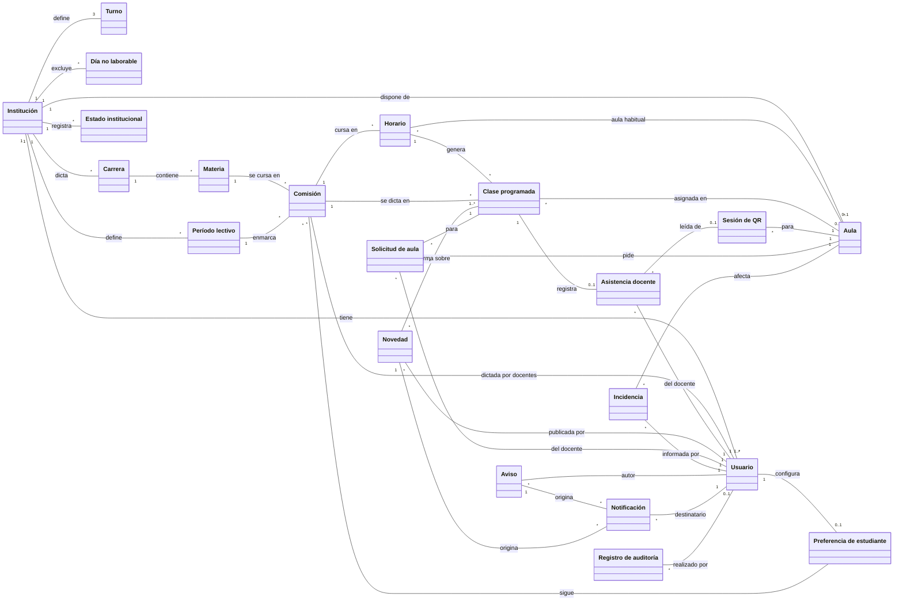

## Institución, usuarios y preferencias

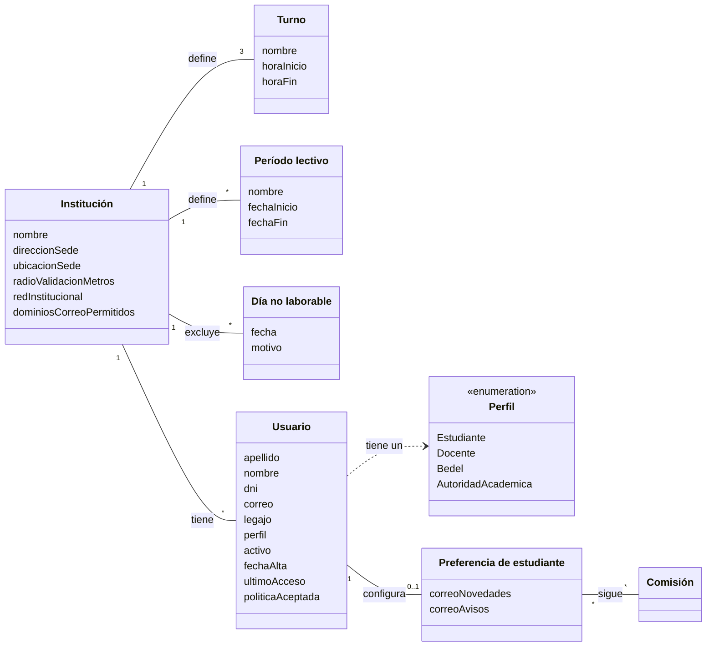

| Concepto                  | Definición                                                                                                      | Atributos                                                                                                                                                                                                                                  | Reglas                                                                                                                                                                                                                           |
| ------------------------- | --------------------------------------------------------------------------------------------------------------- | ------------------------------------------------------------------------------------------------------------------------------------------------------------------------------------------------------------------------------------------ | -------------------------------------------------------------------------------------------------------------------------------------------------------------------------------------------------------------------------------- |
| Institución               | La facultad que opera SiGA. En el MVP, una sola: UTN FRT.                                                       | Nombre; dirección de la sede (Rivadavia 1050, San Miguel de Tucumán); ubicación (coordenadas −26.816955500941518, −65.19835580019078); radio de validación (200 m inicial); identificación de la red institucional; dominios de correo permitidos (lista opcional). | Precargada; los usuarios no crean ni cambian de institución. Sus parámetros se configuran sin tocar código.                                                                                                                     |
| Turno                     | Franja horaria de cursado.                                                                                      | Nombre (Mañana, Tarde, Noche), hora de inicio, hora de fin.                                                                                                                                                                                | Tres turnos por institución; rangos configurables, iniciales 7:00–13:00, 13:00–18:00 y 18:00–23:30. Los turnos no se superponen.                                                                                                 |
| Período lectivo           | Rango de fechas dentro del cual se generan las clases de una comisión.                                          | Nombre (1er cuatrimestre, 2do cuatrimestre, anual), fecha de inicio, fecha de fin.                                                                                                                                                         | Fin posterior al inicio.                                                                                                                                                                                                         |
| Día no laborable          | Fecha en la que no se dictan clases.                                                                            | Fecha, motivo.                                                                                                                                                                                                                             | Una entrada por fecha. Excluye la generación de clases ese día.                                                                                                                                                                  |
| Usuario                   | Persona que accede al sistema.                                                                                  | Apellido, nombre, DNI (7 u 8 dígitos), correo (único), legajo (opcional), perfil, activo, fecha de alta, último acceso, aceptación de la política de privacidad.                                                                            | Correo y DNI únicos. Exactamente un perfil. La desactivación es lógica: conserva todo su historial. Solo Estudiante puede autoasignarse (con correo verificado); el resto lo asigna Bedel o Autoridad.                           |
| Perfil                    | Rol que determina los permisos (matriz en `../producto/requerimientos.md`).                                     | Estudiante, Docente, Bedel, Autoridad académica.                                                                                                                                                                                           | Bedel y Autoridad administran usuarios y datos base; el servidor verifica el permiso en cada operación.                                                                                                                          |
| Preferencia de estudiante | Qué comisiones sigue un estudiante y si quiere correos.                                                         | Comisiones seguidas; correo de novedades (sí/no); correo de avisos (sí/no).                                                                                                                                                                | Una por estudiante. Las comisiones seguidas son el filtro por defecto de "Mis clases". Un correo por novedad o aviso, sin agrupar, solo si la opción está activa.                                                                 |

## Estructura académica y clases programadas

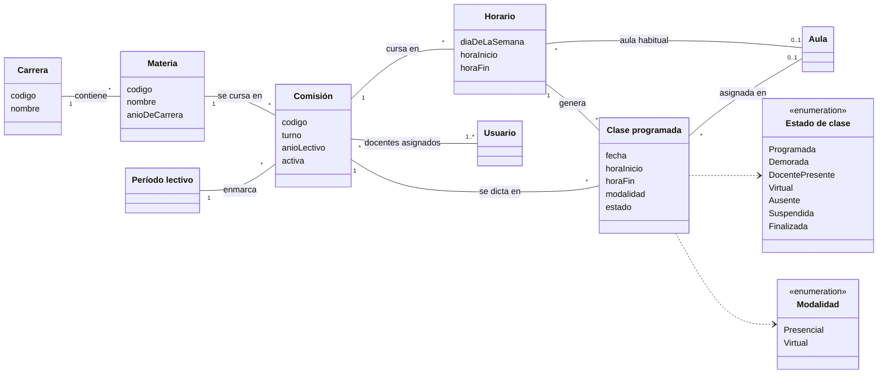

| Concepto         | Definición                                                                                   | Atributos                                                                                                              | Reglas                                                                                                                                                                                                                                                                                                                              |
| ---------------- | -------------------------------------------------------------------------------------------- | ---------------------------------------------------------------------------------------------------------------------- | ----------------------------------------------------------------------------------------------------------------------------------------------------------------------------------------------------------------------------------------------------------------------------------------------------------------------------------- |
| Carrera          | Carrera que dicta la institución.                                                            | Código (único), nombre.                                                                                                | —                                                                                                                                                                                                                                                                                                                                   |
| Materia          | Asignatura de una carrera.                                                                   | Código (único), nombre, año de la carrera.                                                                             | Pertenece a una carrera.                                                                                                                                                                                                                                                                                                            |
| Comisión         | Grupo de cursado de una materia, por ejemplo 5K2.                                            | Código (único), turno, año lectivo, activa.                                                                            | Pertenece a una materia y a un período lectivo. Al menos un docente asignado, todos con perfil Docente. La baja es lógica.                                                                                                                                                                                                          |
| Horario          | Franja semanal de cursado de una comisión.                                                   | Día de la semana, hora de inicio, hora de fin.                                                                         | Fin posterior al inicio. El aula habitual no puede tener otra comisión en la misma franja semanal.                                                                                                                                                                                                                                   |
| Clase programada | Instancia de dictado de una comisión en una fecha concreta. Es el concepto central del dominio. | Fecha, hora de inicio, hora de fin, modalidad (Presencial o Virtual), estado.                                          | Una por comisión, fecha y franja. Se genera a partir del horario entre el inicio y el fin del período, excluyendo días no laborables; nace Programada con el aula habitual. Un aula no puede tener dos clases en franjas superpuestas. Sus transiciones de estado están en el diagrama de estados de abajo. |

## Aulas, solicitudes e incidencias

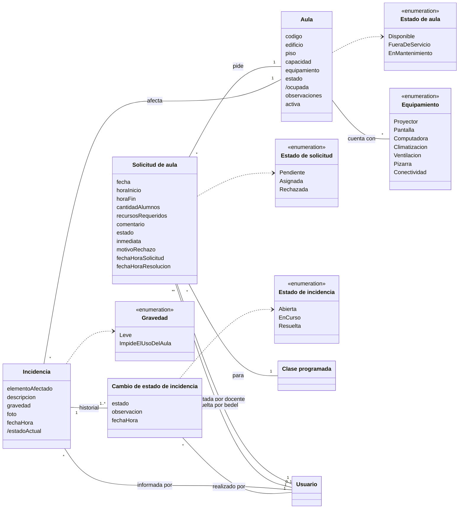

| Concepto                       | Definición                                                           | Atributos                                                                                                                                                                                                                          | Reglas                                                                                                                                                                                                                                                                                                                                                 |
| ------------------------------ | -------------------------------------------------------------------- | ---------------------------------------------------------------------------------------------------------------------------------------------------------------------------------------------------------------------------------- | ------------------------------------------------------------------------------------------------------------------------------------------------------------------------------------------------------------------------------------------------------------------------------------------------------------------------------------------------------ |
| Aula                           | Espacio físico de dictado.                                           | Código (único), edificio, piso, capacidad (entero de 1 a 500), equipamiento, estado editable (Disponible, Fuera de servicio, En mantenimiento), ocupada (derivado), observaciones, activa.                                           | "Ocupada" se calcula en tiempo real a partir de las clases asignadas en curso; no se edita. Solo las aulas Disponibles y activas se ofrecen para asignar. La baja es lógica. Si deja de estar disponible con clases asignadas, esas clases deben reasignarse.                                                                                          |
| Solicitud de aula              | Pedido de un docente de un aula para una clase.                      | Fecha y franja, cantidad estimada de alumnos (mayor que 0), recursos requeridos, comentario, estado, inmediata, motivo de rechazo, fecha y hora de solicitud y de resolución.                                                      | Nace Pendiente. Si la clase no tiene aula y la franja empieza en menos de 30 minutos, nace Asignada con el aula reservada y marcada como inmediata. El motivo es obligatorio al rechazar. Aprobar exige que el aula siga libre en esa franja (verificación atómica).                                                                                   |
| Incidencia                     | Problema de infraestructura o equipamiento de un aula.               | Elemento afectado (proyector, climatización, iluminación, mobiliario, conectividad, otro), descripción (hasta 500 caracteres), gravedad, foto opcional (JPG o PNG, hasta 5 MB), fecha y hora, estado actual (derivado del historial). | Nace Abierta. Si la gravedad es "Impide el uso del aula", el sistema propone poner el aula Fuera de servicio. Al resolverla se puede volver a habilitar el aula.                                                                                                                                                                                        |
| Cambio de estado de incidencia | Cada paso del historial de una incidencia.                           | Estado (Abierta, En curso, Resuelta), observación, fecha y hora.                                                                                                                                                                   | El historial solo crece; nunca se modifica ni se borra. Orden: Abierta → En curso → Resuelta.                                                                                                                                                                                                                                                          |

## Actividad docente

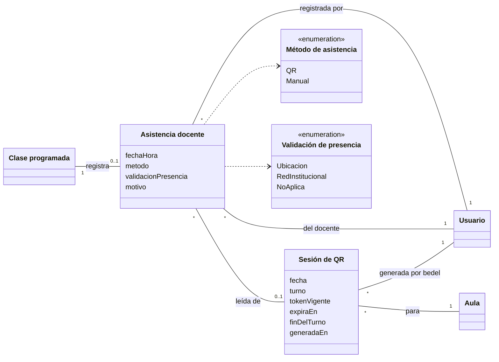

| Concepto           | Definición                                                                 | Atributos                                                                                                                                | Reglas                                                                                                                                                                                                                                                                                                                                                                                      |
| ------------------ | -------------------------------------------------------------------------- | ---------------------------------------------------------------------------------------------------------------------------------------- | ------------------------------------------------------------------------------------------------------------------------------------------------------------------------------------------------------------------------------------------------------------------------------------------------------------------------------------------------------------------------------------------- |
| Sesión de QR       | Código de asistencia que bedelía muestra para un aula, una fecha y un turno. | Fecha, turno, token vigente (firmado), momento de expiración del token, fin del turno, fecha y hora de generación.                       | Solo se genera con la institución Abierta o Abierta con novedades y si el aula tiene clases programadas en ese turno. El token se renueva cada 60 segundos; ningún token se reutiliza; la sesión deja de valer al terminar el turno.                                                                                                                                                       |
| Asistencia docente | Registro de la presencia de un docente para una clase programada.           | Fecha y hora, método (QR o Manual), resultado de la validación de presencia (ubicación, red institucional, o no aplica si es manual), motivo (obligatorio si es manual). | A lo sumo una por clase. Al registrarse, la clase pasa a Docente presente en la misma operación. No se guardan coordenadas: solo el resultado de la validación. Nunca se modifica ni se borra. El registrante es el docente (QR) o el bedel (manual). No se usa para sanciones.                                                                                                             |

## Novedades, estado institucional, avisos y notificaciones

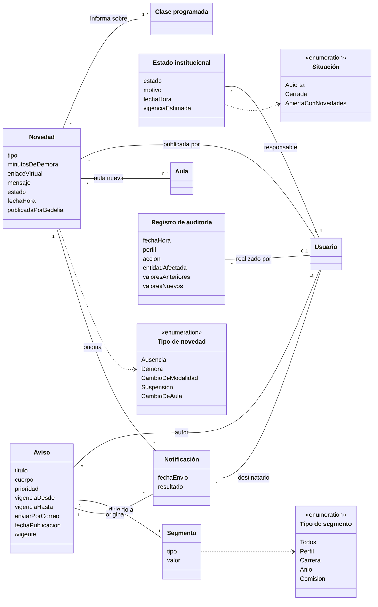

| Concepto              | Definición                                                                                     | Atributos                                                                                                                                                                                                | Reglas                                                                                                                                                                                                                                                                                                                                                                                 |
| --------------------- | ---------------------------------------------------------------------------------------------- | -------------------------------------------------------------------------------------------------------------------------------------------------------------------------------------------------------- | -------------------------------------------------------------------------------------------------------------------------------------------------------------------------------------------------------------------------------------------------------------------------------------------------------------------------------------------------------------------------------------- |
| Novedad               | Información publicada sobre una o más clases de una comisión.                                  | Tipo, minutos de demora (Demora), enlace virtual (Cambio de modalidad), aula nueva (Cambio de aula), mensaje opcional (hasta 500 caracteres), estado (Activa o Finalizada), fecha y hora, quién la publicó. | Abarca una o varias clases de la misma comisión; una sola novedad para un rango de fechas. La publica el docente de la comisión o bedelía (y el sistema, para Cambio de aula). No se publica sobre clases finalizadas. Cada edición queda en el historial; nada se borra. Nunca expone el motivo personal de una ausencia. Cambia el estado de las clases según el tipo (ver abajo). |
| Estado institucional  | Situación de apertura de la institución en un momento dado.                                     | Estado (Abierta, Cerrada, Abierta con novedades), motivo (obligatorio salvo Abierta, hasta 280 caracteres), fecha y hora, vigencia estimada opcional.                                                     | Historial: el vigente es el más reciente; nunca se modifica ni se borra. Un cambio debe ser a un estado distinto del vigente. Pasar a Cerrada suspende las clases programadas afectadas y bloquea la generación de QR.                                                                                                                                                                 |
| Aviso                 | Comunicado oficial de la institución.                                                           | Título (hasta 100 caracteres), cuerpo (hasta 2.000), prioridad (Normal o Urgente), vigencia desde y hasta, si se envía por correo, fecha de publicación, vigente (derivado).                             | Vigencia coherente (hasta ≥ desde). Al vencer deja de mostrarse como activo y se conserva. Los urgentes se muestran también junto al indicador de estado.                                                                                                                                                                                                                              |
| Segmento              | A quién se dirige un aviso.                                                                     | Tipo (Todos, Perfil, Carrera, Año, Comisión) y valor.                                                                                                                                                    | Uno por aviso.                                                                                                                                                                                                                                                                                                                                                                         |
| Notificación          | Correo enviado a un usuario por un aviso o una novedad.                                         | Fecha de envío, resultado (enviado, fallido).                                                                                                                                                            | Se origina en exactamente un aviso o una novedad. Un estudiante la recibe solo si tiene activada la opción correspondiente. Incluye un enlace para dejar de recibir notificaciones.                                                                                                                                                                                                   |
| Registro de auditoría | Evento trazable del sistema.                                                                    | Fecha y hora, usuario, perfil, acción, entidad afectada, valores anteriores y nuevos.                                                                                                                    | Registra inicios de sesión, asistencias, novedades, cambios de aula y de estado institucional, altas y cambios de usuarios, generación de QR, asignaciones, cambios de incidencias y accesos denegados. Ningún perfil lo modifica ni lo elimina.                                                                                                                                        |

## Estados de los conceptos con ciclo de vida

### Clase programada

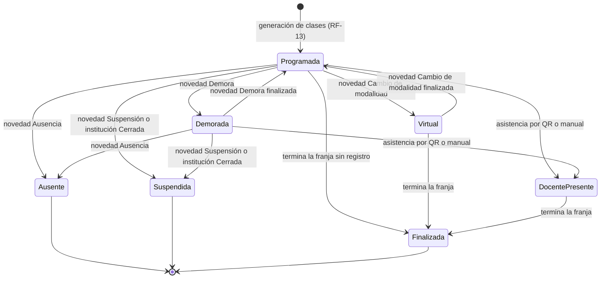

El cambio de aula no modifica el estado: actualiza el aula asignada y genera una novedad. Una clase que termina su franja todavía Programada queda Finalizada sin registro de asistencia, y así se cuenta en el histórico (decisión 4 de `../producto/decisiones-de-producto.md`). Finalizar una novedad de Demora o de Cambio de modalidad devuelve la clase a Programada si no tiene asistencia registrada; Ausente y Suspendida son finales (decisión 17).

### Solicitud de aula

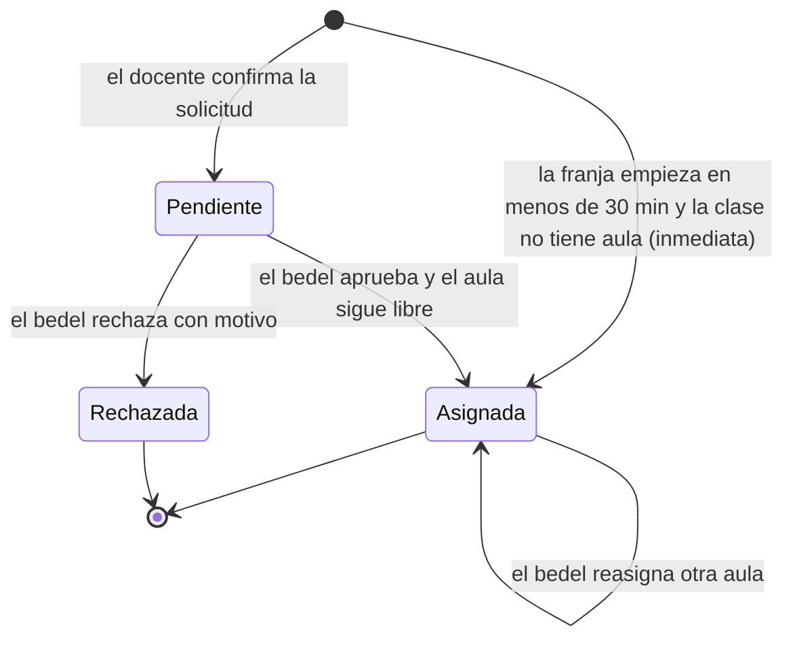

### Incidencia

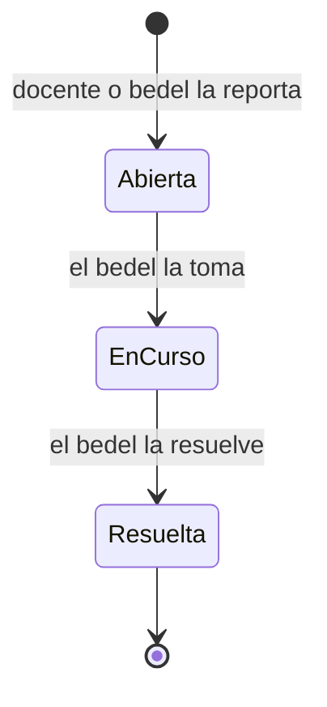

### Aula

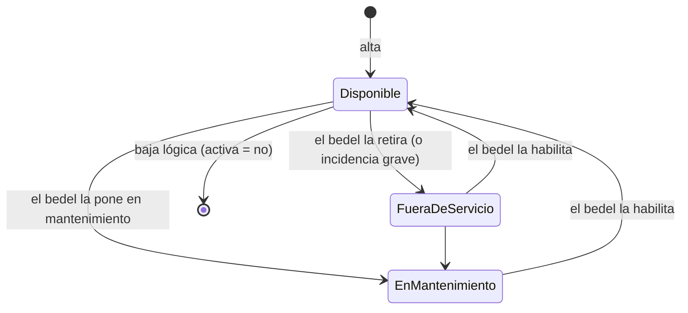

"Ocupada" no es un estado persistido: un aula Disponible se muestra como Ocupada mientras tiene una clase asignada en curso.

### Estado institucional

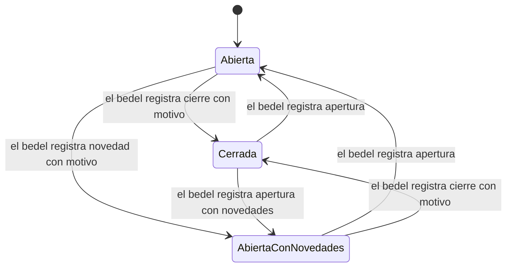

## Invariantes del dominio

Reglas que deben cumplirse en todo momento, independientemente de qué caso de uso las toque. Las implementa el modelo de base de datos (`09-modelo-de-datos.md`, "Reglas implementadas en la base") y los servicios de negocio.

| #     | Invariante                                                                                                                                                                                | Conceptos                                       | Origen                 |
| ----- | ----------------------------------------------------------------------------------------------------------------------------------------------------------------------------------------- | ----------------------------------------------- | ---------------------- |
| INV-1 | Un aula no tiene dos clases programadas en franjas superpuestas. Vale para asignaciones, cambios de aula, aulas habituales de horarios y solicitudes aprobadas o inmediatas.               | Aula, Clase programada, Horario, Solicitud      | RF-16, CA-09, Riesgo 17 |
| INV-2 | Una clase programada tiene a lo sumo una asistencia docente.                                                                                                                              | Clase programada, Asistencia docente            | RF-04, RF-18           |
| INV-3 | Una clase programada es única por comisión, fecha y hora de inicio.                                                                                                                       | Clase programada                                | RF-13                  |
| INV-4 | Asistencias, novedades, estados institucionales, cambios de estado de incidencia y registros de auditoría nunca se modifican ni se eliminan; las correcciones son eventos nuevos.          | Eventos                                         | RNF-03, CA-06          |
| INV-5 | Usuarios, aulas y comisiones se dan de baja de forma lógica; su historial se conserva al menos dos ciclos lectivos.                                                                        | Usuario, Aula, Comisión                         | RNF-03                 |
| INV-6 | Correo y DNI de usuario son únicos en la institución; el código es único en carrera, materia, comisión y aula.                                                                             | Usuario, Carrera, Materia, Comisión, Aula       | RF-10, RF-13, RF-02    |
| INV-7 | Toda novedad abarca clases de una misma comisión, y el dato obligatorio de su tipo está presente (minutos, enlace o aula nueva).                                                           | Novedad, Clase programada                       | RF-05                  |
| INV-8 | Un token de QR vale como máximo 60 segundos, se usa una sola vez por docente y nunca después del fin del turno.                                                                            | Sesión de QR                                    | RF-03, Riesgo 15       |
| INV-9 | Un registro de asistencia manual tiene motivo; uno por QR tiene resultado de validación de presencia y no guarda coordenadas.                                                              | Asistencia docente                              | RF-04, RF-18, PRI      |
| INV-10 | Una notificación se origina en exactamente un aviso o una novedad, y a un estudiante solo le llega si activó esa opción.                                                                  | Notificación, Preferencia de estudiante         | RF-14, RF-17           |
| INV-11 | El estado institucional vigente es el de fecha y hora más reciente; un cambio siempre es a un estado distinto del vigente y, salvo Abierta, lleva motivo.                                 | Estado institucional                            | RF-01                  |
| INV-12 | Los estudiantes solo ven el nombre del docente; DNI, correo y asistencias son visibles solo para Bedel y Autoridad académica.                                                             | Usuario, Asistencia docente                     | PRI                    |

## Correspondencia con el modelo de datos

| Concepto del dominio                           | Tablas (`09-modelo-de-datos.md`)                                     |
| ---------------------------------------------- | -------------------------------------------------------------------- |
| Institución, Turno                             | `organization`, `organization_settings` (turnos como parámetro)      |
| Usuario, Perfil                                | `user`, `member`, `user_profile`                                     |
| Período lectivo, Día no laborable              | `periodo_lectivo`, `dia_no_laborable`                                |
| Carrera, Materia, Comisión, Horario            | `carrera`, `materia`, `comision`, `comision_docente`, `horario`      |
| Clase programada                               | `clase_programada`                                                   |
| Aula                                           | `aula`                                                               |
| Solicitud de aula                              | `solicitud_aula`                                                     |
| Incidencia, Cambio de estado de incidencia     | `incidencia`, `incidencia_estado`                                    |
| Sesión de QR, Asistencia docente               | `sesion_qr`, `asistencia_docente`                                    |
| Novedad                                        | `novedad`, `novedad_clase`                                           |
| Estado institucional                           | `estado_institucional`                                               |
| Aviso, Segmento                                | `aviso` (segmento como tipo y valor)                                 |
| Notificación                                   | `notificacion` + `email_outbox`                                      |
| Preferencia de estudiante                      | `preferencia_estudiante`, `comision_seguida`                         |
| Registro de auditoría                          | `audit_log`                                                          |
