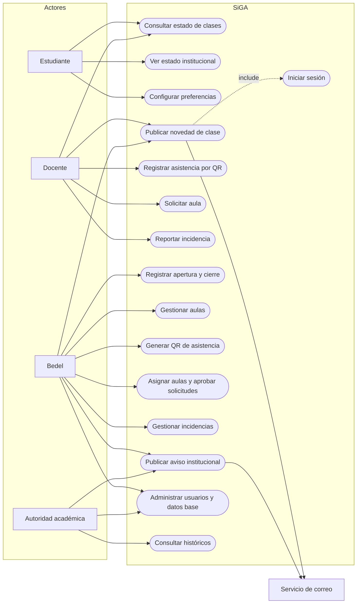
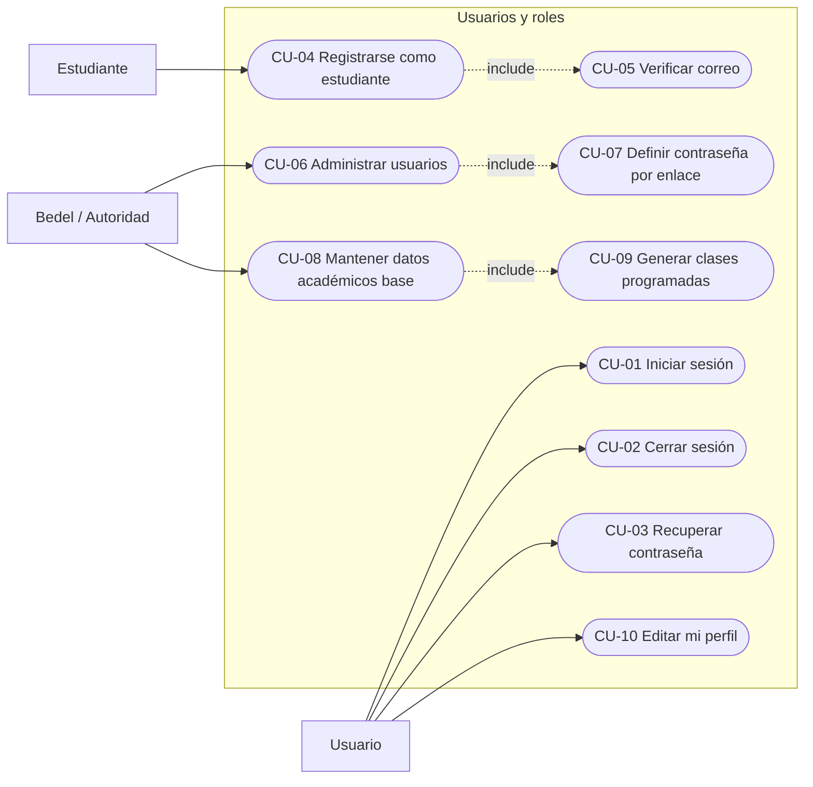
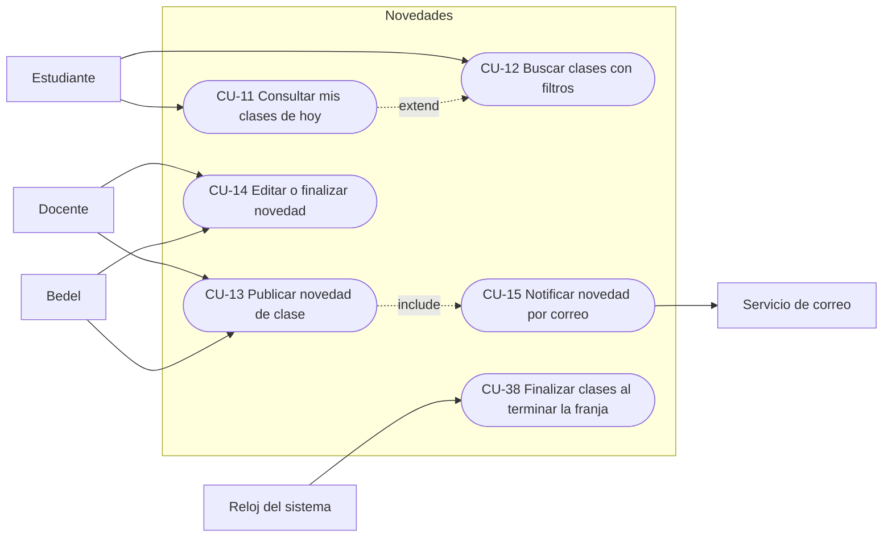
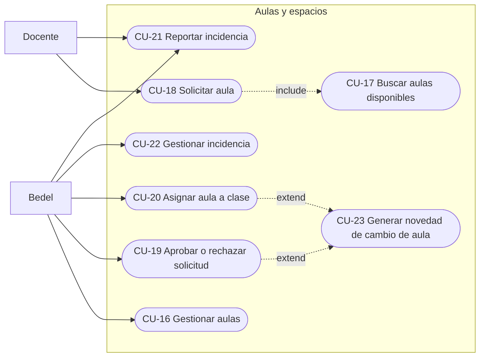
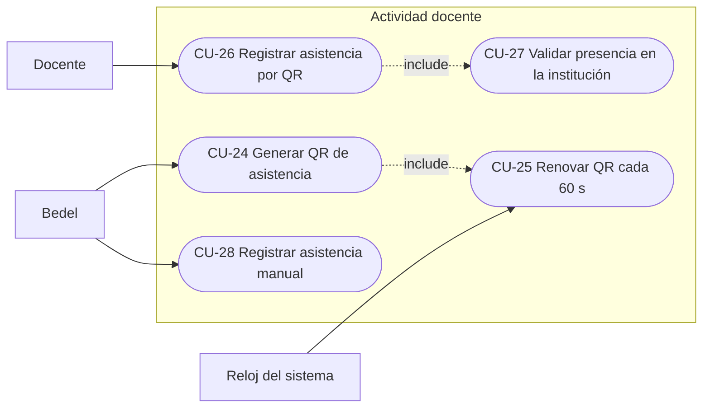
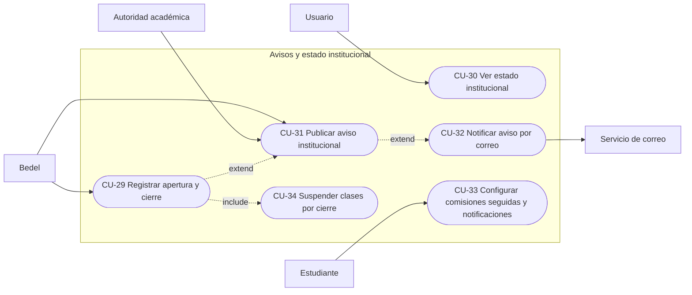
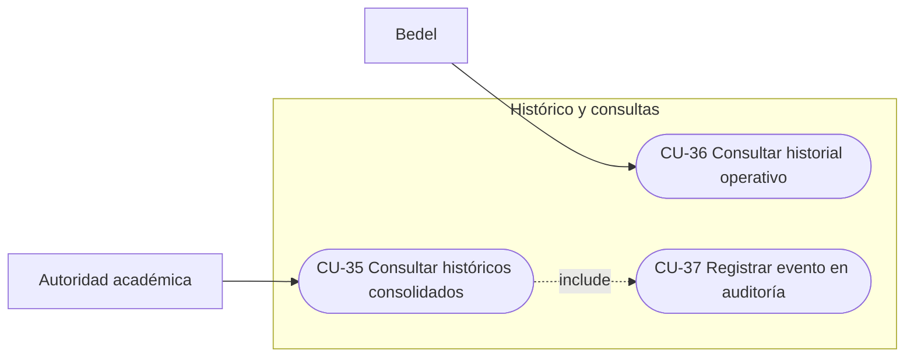

# Diagrama de casos de uso

Actores y casos de uso de SiGA, agrupados por módulo. Cada caso de uso referencia el requisito funcional que lo origina (`../producto/requerimientos.md`); su especificación expandida está en `03-modelo-de-casos-de-uso.md`. Mermaid no tiene diagrama de casos de uso nativo; se representan con `flowchart`: actores como nodos rectangulares a la izquierda, casos de uso como nodos ovalados, `<<include>>` y `<<extend>>` como aristas punteadas.

## Actores

| Actor               | Descripción                                                                                                        | Hereda de |
| ------------------- | ------------------------------------------------------------------------------------------------------------------ | --------- |
| Usuario             | Cualquier persona autenticada.                                                                                     | —         |
| Estudiante          | Consulta clases, avisos y configura sus preferencias.                                                              | Usuario   |
| Docente             | Registra asistencia, publica novedades, solicita aulas, reporta incidencias.                                       | Usuario   |
| Bedel               | Opera la gestión diaria: estado institucional, aulas, QR, solicitudes, incidencias, avisos, usuarios y datos base. | Usuario   |
| Autoridad académica | Consulta históricos, publica avisos, administra usuarios.                                                          | Usuario   |
| Servicio de correo  | Sistema externo que entrega las notificaciones.                                                                    | —         |
| Reloj del sistema   | Actor temporal: finaliza clases al terminar su franja, renueva QR, vence avisos.                                   | —         |

## Diagrama general

## Módulo Usuarios y roles

| CU    | Nombre                         | Actor            | RF    | Resumen                                                                                     |
| ----- | ------------------------------ | ---------------- | ----- | ------------------------------------------------------------------------------------------- |
| CU-01 | Iniciar sesión                 | Usuario          | RF-11 | Correo y contraseña; sesión de 8 h de inactividad; bloqueo 15 min tras 5 intentos fallidos. |
| CU-02 | Cerrar sesión                  | Usuario          | RF-11 | Invalida la sesión.                                                                         |
| CU-03 | Recuperar contraseña           | Usuario          | RF-12 | Enlace de un solo uso válido 60 min; mensaje neutro siempre.                                |
| CU-04 | Registrarse como estudiante    | Estudiante       | RF-10 | Único perfil autoasignable; respeta dominios permitidos si están configurados.              |
| CU-05 | Verificar correo               | Estudiante       | RF-10 | Enlace de verificación; sin verificar no inicia sesión.                                     |
| CU-06 | Administrar usuarios           | Bedel, Autoridad | RF-10 | Alta, edición, desactivación lógica, asignación de perfil y comisiones a docentes.          |
| CU-07 | Definir contraseña por enlace  | Usuario nuevo    | RF-10 | Enlace de activación válido 24 h.                                                           |
| CU-08 | Mantener datos académicos base | Bedel            | RF-13 | Carreras, materias, comisiones, horarios, períodos lectivos, días no laborables.            |
| CU-09 | Generar clases programadas     | Bedel            | RF-13 | A partir de horarios y período, sin superposición de aulas.                                 |
| CU-10 | Editar mi perfil               | Usuario          | PRI-4 | Ver y corregir datos propios, solicitar baja.                                               |

## Módulo Novedades

| CU    | Nombre                       | Actor          | RF           | Resumen                                                                              |
| ----- | ---------------------------- | -------------- | ------------ | ------------------------------------------------------------------------------------ |
| CU-11 | Consultar mis clases de hoy  | Estudiante     | RF-07        | Comisiones seguidas, estado del docente, aula, novedades activas; se actualiza sola. |
| CU-12 | Buscar clases con filtros    | Estudiante     | RF-07        | Carrera, año, comisión, materia, fecha, combinables.                                 |
| CU-13 | Publicar novedad de clase    | Docente, Bedel | RF-05        | Ausencia, demora, virtual, suspensión, cambio de aula; una o varias clases.          |
| CU-14 | Editar o finalizar novedad   | Docente, Bedel | RF-05        | Cada cambio queda en el historial.                                                   |
| CU-15 | Notificar novedad por correo | Sistema        | RF-05, RF-17 | Un correo por novedad a cada estudiante suscripto.                                   |
| CU-38 | Finalizar clases al terminar la franja | Reloj | RF-07   | Toda clase pasa a Finalizada al terminar su horario; sin registro si seguía Programada. |

## Módulo Aulas y espacios

| CU    | Nombre                            | Actor          | RF           | Resumen                                                                 |
| ----- | --------------------------------- | -------------- | ------------ | ----------------------------------------------------------------------- |
| CU-16 | Gestionar aulas                   | Bedel          | RF-02        | Alta, edición, baja lógica; estado; advertencia de clases afectadas.    |
| CU-17 | Buscar aulas disponibles          | Docente        | RF-06        | Por franja, capacidad y recursos; ordenadas por capacidad ajustada.     |
| CU-18 | Solicitar aula                    | Docente        | RF-06        | Queda Pendiente; Asignada inmediata si faltan menos de 30 min.          |
| CU-19 | Aprobar o rechazar solicitud      | Bedel          | RF-16        | Verificación atómica de disponibilidad; motivo obligatorio al rechazar. |
| CU-20 | Asignar aula a clase              | Bedel          | RF-16        | Sin superposición de franjas.                                           |
| CU-21 | Reportar incidencia               | Docente, Bedel | RF-15        | Elemento, descripción, gravedad, foto opcional.                         |
| CU-22 | Gestionar incidencia              | Bedel          | RF-15        | Abierta → En curso → Resuelta; propone Fuera de servicio.               |
| CU-23 | Generar novedad de cambio de aula | Sistema        | RF-16, RF-05 | Automática cuando cambia el aula de una clase publicada.                |

## Módulo Actividad docente

| CU    | Nombre                              | Actor   | RF    | Resumen                                                                              |
| ----- | ----------------------------------- | ------- | ----- | ------------------------------------------------------------------------------------ |
| CU-24 | Generar QR de asistencia            | Bedel   | RF-03 | Por aula, fecha y turno; solo con institución abierta y clases programadas.          |
| CU-25 | Renovar QR cada 60 s                | Reloj   | RF-03 | Token nuevo cada 60 s; inválido al terminar el turno.                                |
| CU-26 | Registrar asistencia por QR         | Docente | RF-04 | Cámara, validación de token, de comisión y de presencia; clase a "Docente presente". |
| CU-27 | Validar presencia en la institución | Sistema | RF-04 | Ubicación dentro del radio (200 m) o red institucional; no guarda coordenadas.       |
| CU-28 | Registrar asistencia manual         | Bedel   | RF-18 | Contingencia con motivo obligatorio; no duplica.                                     |

## Módulo Avisos y estado institucional

| CU    | Nombre                                          | Actor            | RF    | Resumen                                                                      |
| ----- | ----------------------------------------------- | ---------------- | ----- | ---------------------------------------------------------------------------- |
| CU-29 | Registrar apertura y cierre                     | Bedel            | RF-01 | Abierta / Cerrada / Abierta con novedades; motivo obligatorio salvo Abierta. |
| CU-30 | Ver estado institucional                        | Usuario          | RF-08 | Indicador en todas las pantallas; detalle con avisos vigentes.               |
| CU-31 | Publicar aviso institucional                    | Bedel, Autoridad | RF-14 | Segmentado por perfil, carrera, año o comisión; vigencia; prioridad.         |
| CU-32 | Notificar aviso por correo                      | Sistema          | RF-14 | Según preferencias del estudiante; registra resultado de cada envío.         |
| CU-33 | Configurar comisiones seguidas y notificaciones | Estudiante       | RF-17 | Comisiones seguidas y opciones de correo.                                    |
| CU-34 | Suspender clases por cierre                     | Sistema          | RF-01 | Al cerrar la institución, las clases afectadas pasan a Suspendida.           |

## Módulo Histórico y consultas

| CU    | Nombre                            | Actor     | RF     | Resumen                                                                                         |
| ----- | --------------------------------- | --------- | ------ | ----------------------------------------------------------------------------------------------- |
| CU-35 | Consultar históricos consolidados | Autoridad | RF-09  | Asistencia, novedades, uso de aulas, incidencias; rango máximo 12 meses; indicadores y detalle. |
| CU-36 | Consultar historial operativo     | Bedel     | RF-09  | Historial de aulas, asistencias e incidencias.                                                  |
| CU-37 | Registrar evento en auditoría     | Sistema   | RNF-03 | Todo evento relevante con fecha, hora, usuario y valores anteriores y nuevos; inmutable.        |
