# Mockups

Pantallas principales de SiGA, una por caso de uso real (`07-casos-de-uso-reales.md`). Las de móvil (M1–M8) corresponden a los perfiles Estudiante y Docente; las de escritorio (D1–D8), a Bedel y Autoridad académica.

## Archivo de Figma

**SiGA – Mockups TP7**, equipo "facultad": <https://www.figma.com/design/XXztR4XV8JjjKxCuD7mZWO>

- Página "Mobile – Estudiante y Docente": M1 a M8, frames de 390×844.
- Página "Desktop – Bedel y Autoridad": creada, pero vacía (ver "Estado y pendientes").

## Sistema visual

Equivalente al tema del repo (`../ui.md`, ADR 007): shadcn/ui estilo `base-nova`, color base neutral, radios de 8 a 10 px, iconos de trazo fino estilo lucide, tipografía Google Sans (en Figma, Google Sans Flex; M1 a M7 quedaron en Inter, ver pendientes).

| Uso                                                  | Color                             |
| ---------------------------------------------------- | --------------------------------- |
| Fondo / superficie / borde                           | `#FFFFFF` / `#F4F4F5` / `#E4E4E7` |
| Texto / texto secundario / primario                  | `#09090B` / `#71717A` / `#18181B` |
| Docente presente, Abierta, Resuelta, Aprobada        | Verde `#16A34A`                   |
| Demorada, Abierta con novedades, Pendiente, En curso | Amarillo `#CA8A04`                |
| Suspendida, Ausente, Cerrada, Rechazada, Urgente     | Rojo `#DC2626`                    |
| Virtual, Ocupada, Asignada (inmediata)               | Azul `#2563EB`                    |
| Programada / Sin registrar, Leve, Finalizada         | Gris `#71717A`                    |

Todo estado se muestra con color, icono y texto a la vez. El indicador de estado institucional aparece en todas las pantallas: en móvil como franja bajo el título, en escritorio como píldora a la derecha del título de página.

## Pantallas

| Id  | Pantalla                    | Perfil            | Caso de uso real | Figma (nodeId) | Captura          |
| --- | --------------------------- | ----------------- | ---------------- | -------------- | ---------------- |
| M1  | Inicio de sesión            | Todos             | CUR-01           | `1:3`          | `mockups/M1.png` |
| M2  | Mis clases de hoy           | Estudiante        | CUR-02           | `2:2`          | `mockups/M2.png` |
| M3  | Preferencias                | Estudiante        | CUR-03           | `2:74`         | `mockups/M3.png` |
| M4  | Avisos                      | Estudiante        | CUR-04           | `3:2`          | `mockups/M4.png` |
| M5  | Mis clases                  | Docente           | CUR-05           | `3:61`         | `mockups/M5.png` |
| M6  | Publicar novedad            | Docente           | CUR-05           | `4:2`          | `mockups/M6.png` |
| M7  | Registrar asistencia        | Docente           | CUR-06           | `4:81`         | `mockups/M7.png` |
| M8  | Solicitar aula              | Docente           | CUR-07           | `5:2`          | `mockups/M8.png` |
| D1  | Estado institucional        | Bedel             | CUR-08           | pendiente      | `mockups/D1.png` |
| D2  | Aulas                       | Bedel             | CUR-09           | pendiente      | `mockups/D2.png` |
| D3  | QR de asistencia            | Bedel             | CUR-10           | pendiente      | `mockups/D3.png` |
| D4  | Solicitudes                 | Bedel             | CUR-11           | pendiente      | `mockups/D4.png` |
| D5  | Incidencias                 | Bedel             | CUR-12           | pendiente      | `mockups/D5.png` |
| D6  | Avisos                      | Bedel / Autoridad | CUR-13           | pendiente      | `mockups/D6.png` |
| D7  | Usuarios y datos académicos | Bedel / Autoridad | CUR-14           | pendiente      | `mockups/D7.png` |
| D8  | Consultas históricas        | Autoridad         | CUR-15           | pendiente      | `mockups/D8.png` |

Para abrir un frame en Figma: `https://www.figma.com/design/XXztR4XV8JjjKxCuD7mZWO?node-id=<nodeId con guion>` (por ejemplo `node-id=2-2` para M2).

### Móvil

|                                          |                                         |                                            |                                      |
| ---------------------------------------- | --------------------------------------- | ------------------------------------------ | ------------------------------------ |
| 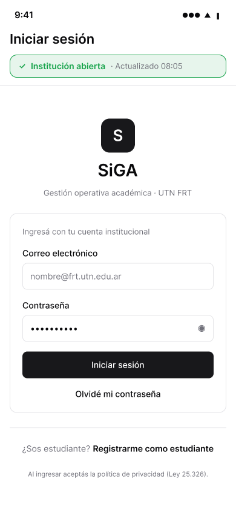   | 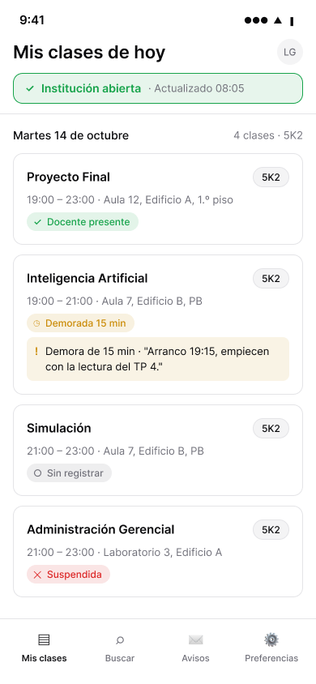 | 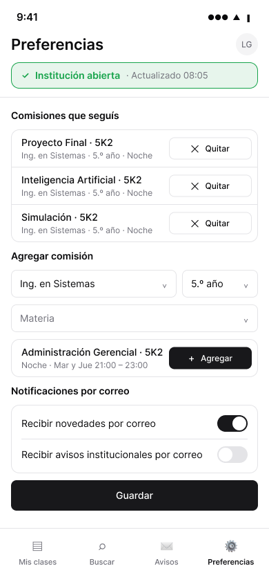         | 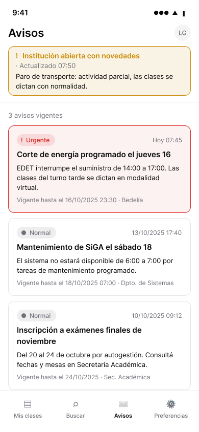         |
| 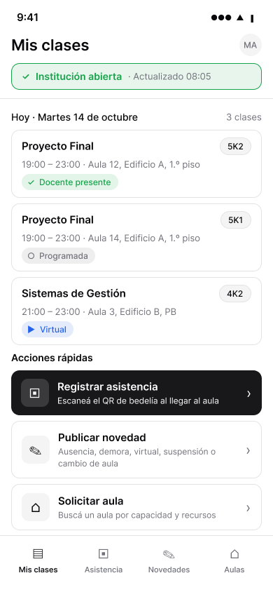 | 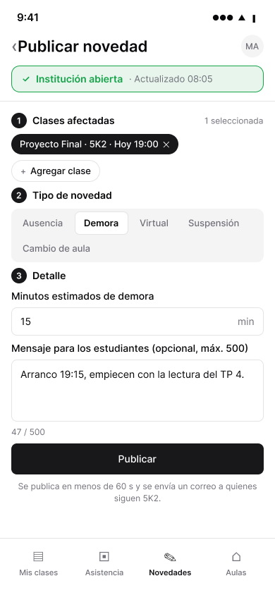  | 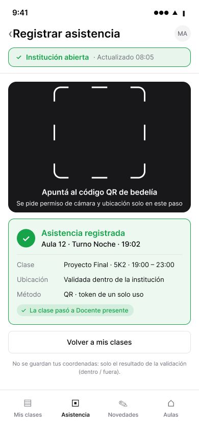 | 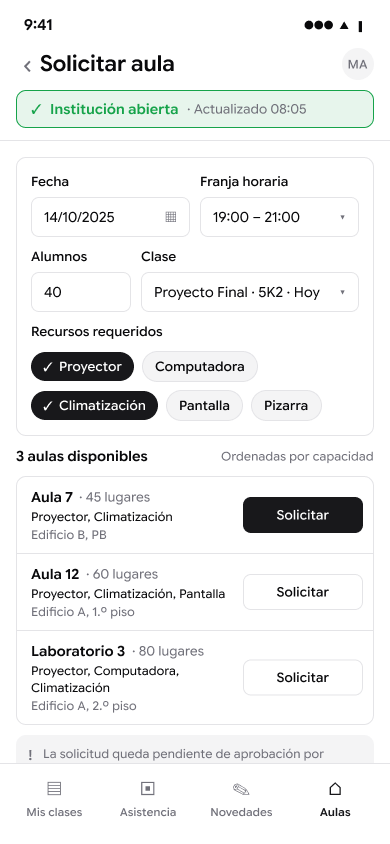 |

### Escritorio

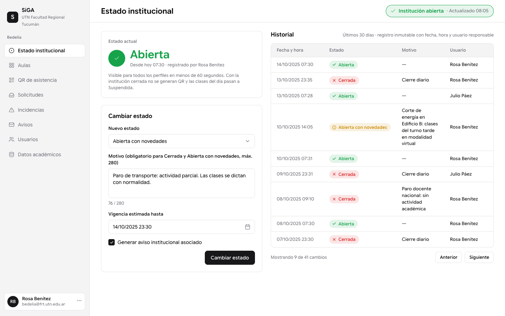

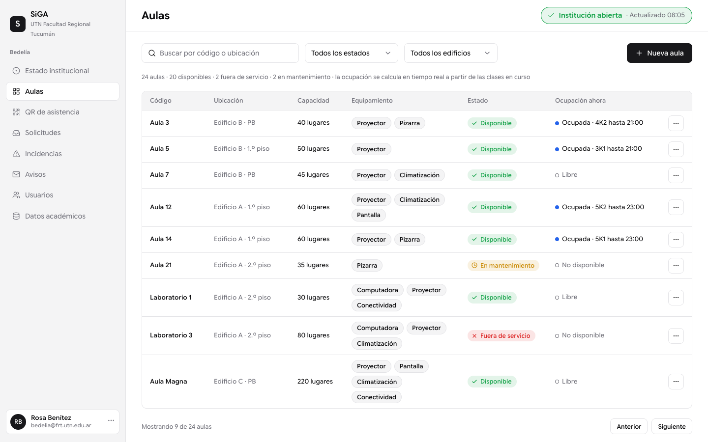

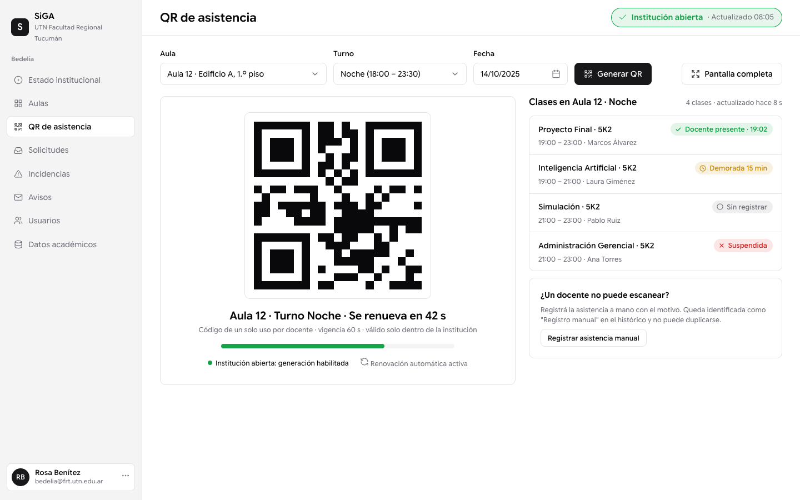

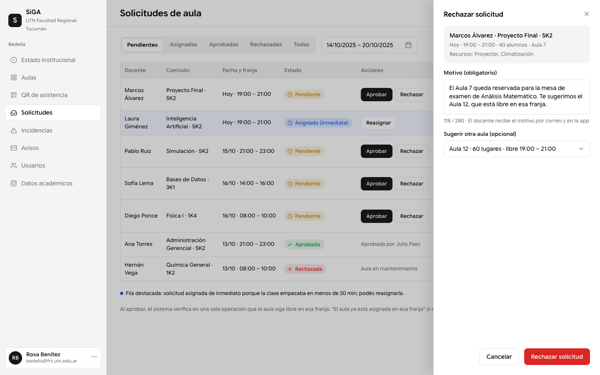

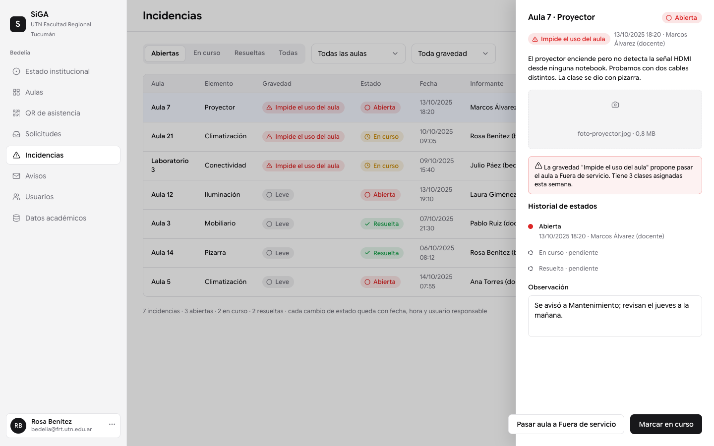

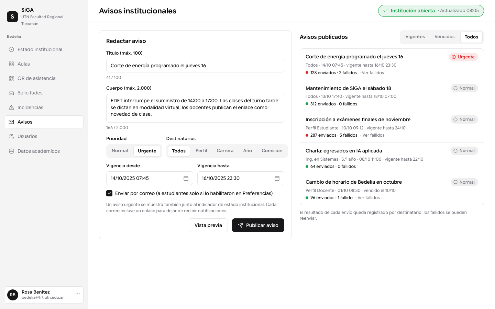

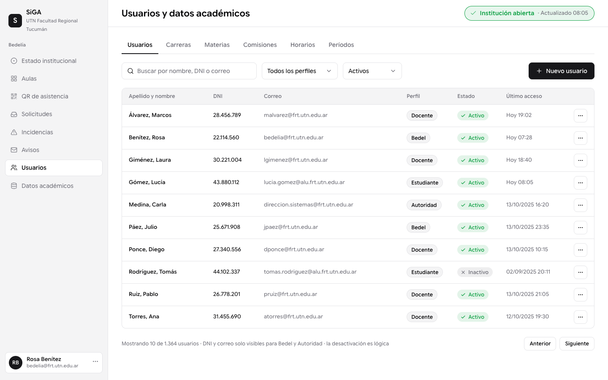

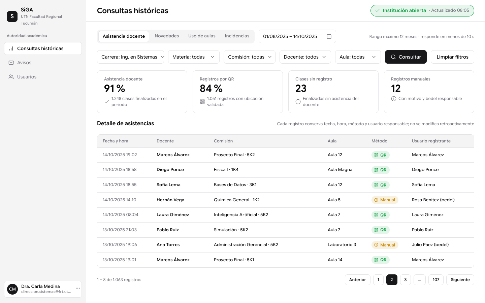

## Decisiones de diseño tomadas en los mockups

- Navegación inferior del estudiante: Mis clases, Buscar, Avisos, Preferencias. Del docente: Mis clases, Asistencia, Novedades, Aulas.
- La pantalla de inicio de sesión también muestra el estado institucional, por ser información pública.
- En D4 (Solicitudes) y D5 (Incidencias) el detalle y el rechazo se abren en un panel lateral (Sheet). `../ui.md` indica que los formularios van en diálogo centrado y que el único Sheet es el menú móvil, así que al implementar hay que decidir entre respetar el mockup o pasar esos paneles a Dialog.
- Datos de ejemplo: comisión 5K2 de Ingeniería en Sistemas, bedel "Rosa Benítez", autoridad "Dra. Carla Medina".
- El QR de D3 es ilustrativo, no escaneable.

## Estado y pendientes

- El MCP de Figma en el plan Starter admite 20 llamadas por mes y se agotó al terminar las pantallas móviles. Las de escritorio se construyeron con el mismo sistema visual en HTML (`mockups/html/D1.html` a `D8.html`, renderizados a PNG 1440×900 con Chrome headless mediante `mockups/html/build.py`) y quedan por recrear en la página "Desktop – Bedel y Autoridad" cuando se renueve la cuota o con un plan superior.
- M1 a M7 están en Inter en Figma; M8 y las de escritorio en Google Sans Flex. Falta la pasada de reemplazo de fuente.
- M8: la nota al pie ("La solicitud queda pendiente…") se corta en la última línea; la corrección quedó pendiente por el mismo límite.
