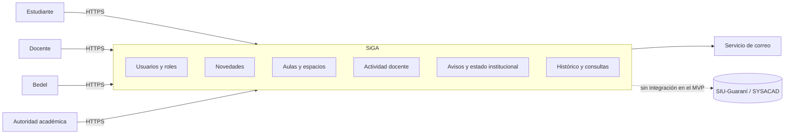

# Especificación de requisitos de software

SiGA, sistema web de gestión operativa académica. Versión 1.1 (14/10/2026), derivada de la ERS v1.0 del 28/09/2026 (`../producto/fuentes/ers-siga-v1.0.md`) con las decisiones de producto registradas en `../producto/decisiones-de-producto.md`. Estructura según IEEE 830-1998. Las menciones tecnológicas de la ERS v1.0 se reemplazan por el stack definido en este repo (`../arquitectura.md`).

## 1. Introducción

### 1.1 Propósito

Definir de manera clara y verificable las funcionalidades, restricciones y atributos de calidad de SiGA. Es el acuerdo entre el equipo y los interesados sobre qué se construye y la base de diseño, desarrollo, pruebas y aceptación del MVP. Audiencias: equipo de desarrollo, Director de proyecto, Tutor y Cátedra, Directora de Carrera y Departamento de Sistemas (cliente), bedelía, docentes y representantes estudiantiles.

### 1.2 Alcance

SiGA centraliza y comunica en tiempo real la información operativa del cursado presencial de la UTN FRT: estado de apertura de la institución, disponibilidad y estado de las aulas, asistencia y presencia docente, novedades de cada clase y avisos institucionales. Complementa a SIU-Guaraní y SYSACAD; no los reemplaza.

**El sistema hará**: registrar y publicar el estado institucional; gestionar aulas, su disponibilidad, ocupación e incidencias; generar QR de asistencia docente y registrar la asistencia solo dentro de la institución; permitir a los docentes publicar novedades y solicitar aulas; permitir a los estudiantes consultar en tiempo real el estado de sus clases con filtros; publicar avisos segmentados y notificarlos por correo; registrar un historial trazable y ofrecer consultas consolidadas; administrar usuarios con cuatro perfiles.

**El sistema no hará**: inscripciones, notas, historial académico ni trámites; integración automática con sistemas académicos; liquidación de haberes, control horario laboral ni sanciones; aplicaciones móviles nativas; gestión de mantenimiento edilicio más allá de las incidencias de aulas.

Objetivo general, beneficios y contexto: `../producto/vision.md`.

### 1.3 Definiciones, acrónimos y abreviaturas

Glosario en `../producto/requerimientos.md` (sección Glosario). Abreviaturas usadas acá: RF (requisito funcional), RNF (requisito no funcional), CA (criterio de aceptación), CU (caso de uso), MVP (producto mínimo viable), UTN FRT (Universidad Tecnológica Nacional, Facultad Regional Tucumán), ISI (Ingeniería en Sistemas de Información).

### 1.4 Referencias

| Documento                                                                                                                                     | Ubicación                       |
| --------------------------------------------------------------------------------------------------------------------------------------------- | ------------------------------- |
| IEEE 830-1998, ISO/IEC/IEEE 29148                                                                                                             | Estándares de referencia.       |
| ERS v1.0, Matriz de Trazabilidad V1.2, Acta de Constitución V2, Declaración del Alcance V2, EDT v3.0, Registro de Riesgos, Plan de Gestión V1 | `../producto/fuentes/README.md` |
| Visión de producto, catálogo de requisitos, especificaciones por módulo, decisiones de producto                                               | `../producto/`                  |
| Ley 25.326 de Protección de los Datos Personales; WCAG 2.1; OWASP Top 10                                                                      | Normativa y guías externas.     |

### 1.5 Visión general del documento

La sección 2 describe el sistema en su contexto: perspectiva, funciones, usuarios, restricciones, supuestos y requisitos futuros. La sección 3 detalla interfaces externas, requisitos funcionales, de datos y no funcionales. Los apéndices traen la matriz de trazabilidad, los criterios de aceptación, la matriz de permisos y el modelo de estados de una clase.

## 2. Descripción general

### 2.1 Perspectiva del sistema

SiGA es un producto nuevo e independiente. Convive con SIU-Guaraní y SYSACAD sin intercambiar datos en esta versión. Es una aplicación web responsiva e instalable (PWA), accesible desde cualquier navegador moderno. El acceso a la cámara y a la ubicación del dispositivo se realiza mediante las APIs estándar del navegador, solo al registrar asistencia y con consentimiento explícito.

### 2.2 Funciones del sistema

| Módulo                         | Funciones principales                                                                                                                                                                                                   | Requisitos                 |
| ------------------------------ | ----------------------------------------------------------------------------------------------------------------------------------------------------------------------------------------------------------------------- | -------------------------- |
| Usuarios y roles (transversal) | Inicio y cierre de sesión; recuperación de contraseña; autorregistro de estudiantes con verificación; alta, edición y baja de usuarios; asignación de perfil; datos académicos base y generación de clases programadas. | RF-10, RF-11, RF-12, RF-13 |
| Novedades                      | Publicación, edición y cierre de novedades de clase; consulta en tiempo real del estado de las clases con filtros combinados.                                                                                           | RF-05, RF-07               |
| Aulas y espacios               | ABM de aulas; disponibilidad y ocupación calculada; solicitud de aula; asignación sin superposiciones; incidencias.                                                                                                     | RF-02, RF-06, RF-15, RF-16 |
| Actividad docente              | Generación de QR por aula, fecha y turno; registro por escaneo con validación de presencia; registro manual de contingencia.                                                                                            | RF-03, RF-04, RF-18        |
| Avisos y estado institucional  | Estado de apertura; indicador en todas las pantallas; avisos segmentados con correo; preferencias del estudiante.                                                                                                       | RF-01, RF-08, RF-14, RF-17 |
| Histórico y consultas          | Auditoría inmutable de todos los eventos; consultas consolidadas para autoridades.                                                                                                                                      | RF-09, RNF-03              |

### 2.3 Características de los usuarios

| Perfil              | Nivel técnico y contexto                                                           | Frecuencia                             | Funciones                                                                                 |
| ------------------- | ---------------------------------------------------------------------------------- | -------------------------------------- | ----------------------------------------------------------------------------------------- |
| Estudiante          | Uso habitual de smartphone; muchos trabajan o viajan. Mayormente desde el celular. | Diaria.                                | Consultar estado institucional, clases, aulas, novedades y avisos; preferencias.          |
| Docente             | Nivel variable; usa el celular para escanear el QR.                                | En cada clase y ante imprevistos.      | Registrar asistencia, publicar novedades, solicitar aulas, reportar incidencias.          |
| Bedel               | Experiencia operativa; PC en bedelía, a veces tablet o celular.                    | Continua en horario de funcionamiento. | Estado institucional, aulas, QR, solicitudes, incidencias, avisos, usuarios y datos base. |
| Autoridad académica | Nivel básico a intermedio.                                                         | Semanal o mensual.                     | Históricos consolidados; avisos; administración de usuarios.                              |

### 2.4 Restricciones

| Id    | Restricción                                                                                                        |
| ----- | ------------------------------------------------------------------------------------------------------------------ |
| RES-1 | Versión final antes del 18/11/2026, según el calendario de la cátedra.                                             |
| RES-2 | Equipo de cuatro estudiantes a tiempo parcial; el alcance del MVP se limita a los módulos definidos.               |
| RES-3 | Cumplimiento de la Ley 25.326 y de las políticas institucionales de la UTN FRT.                                    |
| RES-4 | Aplicación web; sin aplicaciones nativas.                                                                          |
| RES-5 | Interfaz, mensajes y ayuda en español.                                                                             |
| RES-6 | Avisos y recuperación de contraseña por correo electrónico; sin SMS ni mensajería con costo por mensaje.           |
| RES-7 | Las pruebas piloto en el entorno real dependen de la aprobación de las autoridades y del Departamento de Sistemas. |
| RES-8 | Todo cambio a los requisitos aprobados pasa por el control de cambios del Plan de Gestión.                         |
| RES-9 | Stack definido en este repo (`../arquitectura.md`); servicios con planes gratuitos o de bajo costo.                |

### 2.5 Suposiciones y dependencias

| Id    | Supuesto                                                                                                       |
| ----- | -------------------------------------------------------------------------------------------------------------- |
| SUP-1 | Hay conexión a internet y Wi-Fi institucional en las áreas de uso.                                             |
| SUP-2 | Los docentes tienen smartphone con cámara y aceptan dar permiso de cámara y ubicación al registrar asistencia. |
| SUP-3 | La presencia en la institución se valida por ubicación (principal) o por red institucional (alternativa).      |
| SUP-4 | Secretaría Académica o bedelía proveen los datos académicos base al inicio del ciclo.                          |
| SUP-5 | Los proveedores de infraestructura mantienen disponibilidad y planes gratuitos o de bajo costo.                |
| SUP-6 | Bedeles, docentes, estudiantes y autoridades participan de la validación y las pruebas de aceptación.          |
| SUP-7 | La institución autoriza pruebas piloto en 2026, inicialmente en ISI.                                           |
| SUP-8 | La organización académica es carreras → años → materias → comisiones → turnos.                                 |
| SUP-9 | Una sola institución (UTN FRT) en el MVP.                                                                      |

### 2.6 Requisitos futuros

Integración con SIU-Guaraní y SYSACAD; importación masiva desde CSV o Excel; multi-institución; extensión a todas las carreras; notificaciones push y canales adicionales; exportación de reportes a PDF y Excel y tablero de indicadores; reserva anticipada de aulas; derivación de incidencias a mantenimiento; registro de temas dictados.

## 3. Requisitos específicos

### 3.1 Interfaces externas

**Interfaces de usuario**

| Id   | Requisito                                                                                                                                                                                                                                                                                                                              |
| ---- | -------------------------------------------------------------------------------------------------------------------------------------------------------------------------------------------------------------------------------------------------------------------------------------------------------------------------------------- |
| IU-1 | Interfaz web responsiva desde 360 px de ancho hasta escritorio, sin desplazamiento horizontal.                                                                                                                                                                                                                                         |
| IU-2 | Panel principal por perfil: Estudiante (Mis clases de hoy, estado institucional, avisos); Docente (Mis clases, Registrar asistencia, Publicar novedad, Solicitar aula); Bedel (Estado institucional, Aulas, QR de asistencia, Solicitudes, Incidencias, Avisos, Usuarios, Datos académicos); Autoridad (Consultas históricas, Avisos). |
| IU-3 | Indicador de estado institucional destacado en la parte superior de todas las pantallas.                                                                                                                                                                                                                                               |
| IU-4 | Estados de clase y de aula con color, icono y texto a la vez.                                                                                                                                                                                                                                                                          |
| IU-5 | La pantalla de registro de asistencia abre directamente la cámara.                                                                                                                                                                                                                                                                     |
| IU-6 | La pantalla de QR muestra el código en tamaño grande con aula, turno y tiempo restante.                                                                                                                                                                                                                                                |
| IU-7 | Validación de formularios al ingresar datos, con errores junto al campo, en español.                                                                                                                                                                                                                                                   |
| IU-8 | Identidad visual única: componentes de shadcn/ui, sin componentes visuales propios (`../ui.md`).                                                                                                                                                                                                                                       |

**Interfaces de hardware**: sin hardware específico. El dispositivo del docente debe tener cámara y, preferentemente, servicios de ubicación. La pantalla que muestra el QR debe ser legible a 50 cm como mínimo.

**Interfaces de software**: servicio de correo transaccional para avisos, novedades, verificación y recuperación de contraseña; almacenamiento de objetos para fotos de incidencias; APIs del navegador de cámara (`getUserMedia`) y geolocalización. Navegadores soportados: Chrome, Firefox, Safari y Edge en sus dos últimas versiones, escritorio y móvil; Android 10+ e iOS 15+.

**Interfaces de comunicación**: HTTPS en toda comunicación; API HTTP con JSON documentada con OpenAPI (`/api/v1`); actualización en tiempo real por consulta periódica cada 30 segundos, de modo que la latencia no supere los 60 segundos.

### 3.2 Requisitos funcionales

Prioridad: Alta = imprescindible para el MVP; Media = necesaria, puede entregarse simplificada. El detalle de entrada, proceso, salida y reglas de cada requisito está en la especificación de su módulo.

| Id    | Requisito                                                                                                                                                   | Prioridad | Entradas principales                                                                 | Salidas principales                                                                                     | CA           | Especificación                     |
| ----- | ----------------------------------------------------------------------------------------------------------------------------------------------------------- | --------- | ------------------------------------------------------------------------------------ | ------------------------------------------------------------------------------------------------------- | ------------ | ---------------------------------- |
| RF-01 | El sistema permitirá al bedel registrar la apertura y el cierre de la institución y las novedades institucionales que afecten su funcionamiento.            | Alta      | Estado, fecha y hora, motivo (obligatorio salvo Abierta, máx. 280), vigencia.        | Estado visible para todos en < 60 s; clases suspendidas si Cerrada; opción de aviso asociado.           | CA-01        | `avisos-y-estado-institucional.md` |
| RF-02 | El sistema permitirá al bedel dar de alta, modificar, consultar y dar de baja aulas con capacidad, equipamiento, estado y disponibilidad.                   | Alta      | Código único, ubicación, capacidad 1–500, equipamiento, estado, observaciones.       | Aula visible en listados en < 60 s; clases afectadas si deja de estar disponible.                       | CA-03        | `aulas-y-espacios.md`              |
| RF-03 | El sistema generará un código QR de asistencia vinculado a fecha, aula y turno, utilizable solo dentro de la institución y por perfiles autorizados.        | Alta      | Aula, fecha, turno.                                                                  | QR renovado cada 60 s con tiempo restante; error si institución cerrada o sin clases.                   | CA-02        | `actividad-docente.md`             |
| RF-04 | El sistema permitirá al docente registrar su asistencia escaneando el QR desde su dispositivo.                                                              | Alta      | Token del QR, docente autenticado, ubicación o red.                                  | Asistencia registrada; clase en "Docente presente" en < 60 s; errores específicos.                      | CA-02        | `actividad-docente.md`             |
| RF-05 | El sistema permitirá al docente (y al bedel) publicar, modificar y finalizar novedades: ausencia, demora, cambio de modalidad, suspensión o cambio de aula. | Alta      | Clase(s), tipo, dato del tipo, mensaje ≤ 500.                                        | Novedad visible en < 60 s; correo a suscriptos; estado de clase actualizado.                            | CA-03        | `novedades.md`                     |
| RF-06 | El sistema permitirá al docente buscar aulas disponibles por cantidad de alumnos y recursos, y solicitar una.                                               | Media     | Clase, franja, alumnos, recursos.                                                    | Lista ordenada por capacidad ajustada; solicitud Pendiente o Asignada inmediata (< 30 min).             | CA-04        | `aulas-y-espacios.md`              |
| RF-07 | El sistema permitirá al estudiante consultar en tiempo real el estado de sus clases, filtrando por carrera, año, comisión y materia.                        | Alta      | Filtros combinables, fecha; comisiones seguidas por defecto.                         | Listado con aula, estado del docente y novedades; se actualiza solo.                                    | CA-03, CA-04 | `novedades.md`                     |
| RF-08 | El sistema mostrará a todos los perfiles el estado general de la institución.                                                                               | Alta      | Estado vigente y avisos activos.                                                     | Indicador actualizado en < 60 s; detalle con avisos vigentes.                                           | CA-01, CA-03 | `avisos-y-estado-institucional.md` |
| RF-09 | El sistema permitirá a las autoridades consultar información histórica consolidada: asistencia, novedades, uso de aulas e incidencias.                      | Media     | Tipo, rango ≤ 12 meses, filtros.                                                     | Indicadores y detalle paginado con fecha, hora y usuario.                                               | CA-06        | `historico-y-consultas.md`         |
| RF-10 | El sistema gestionará cuatro perfiles con permisos diferenciados y permitirá alta, modificación, desactivación y asignación de perfil.                      | Alta      | Datos del usuario, DNI 7–8 dígitos, correo, perfil, comisiones.                      | Usuario con perfil; enlace de activación 24 h; autorregistro de estudiantes con verificación de correo. | CA-05        | `usuarios-y-roles.md`              |
| RF-11 | El sistema requerirá inicio de sesión para toda funcionalidad protegida.                                                                                    | Alta      | Correo y contraseña.                                                                 | Sesión de 8 h de inactividad; bloqueo 15 min tras 5 intentos.                                           | CA-05        | `usuarios-y-roles.md`              |
| RF-12 | El sistema permitirá restablecer la contraseña mediante un enlace de un solo uso enviado al correo.                                                         | Media     | Correo; nueva contraseña.                                                            | Enlace válido 60 min; sesiones cerradas; mensaje neutro siempre.                                        | CA-05        | `usuarios-y-roles.md`              |
| RF-13 | El sistema permitirá al bedel mantener carreras, materias, comisiones, horarios, períodos lectivos y docentes asignados, y generará las clases programadas. | Alta      | Entidades académicas, períodos, días no laborables.                                  | Clases programadas sin superposición de aulas.                                                          | CA-09        | `usuarios-y-roles.md`              |
| RF-14 | El sistema permitirá a bedeles y autoridades publicar avisos institucionales segmentados y notificarlos por correo.                                         | Alta      | Título ≤ 100, cuerpo ≤ 2.000, prioridad, destinatarios, vigencia, enviar por correo. | Aviso visible en < 60 s; resultado de cada envío.                                                       | CA-03        | `avisos-y-estado-institucional.md` |
| RF-15 | El sistema permitirá a docentes y bedeles reportar incidencias de un aula y a bedelía gestionarlas hasta su resolución.                                     | Media     | Aula, elemento, descripción ≤ 500, gravedad, foto ≤ 5 MB.                            | Incidencia con historial de estados; propuesta de Fuera de servicio.                                    | CA-06        | `aulas-y-espacios.md`              |
| RF-16 | El sistema permitirá al bedel asignar aulas y aprobar o rechazar solicitudes, impidiendo superposiciones.                                                   | Alta      | Solicitud o clase, aula, decisión, motivo si rechaza.                                | Asignación atómica; novedad automática de cambio de aula; notificación al docente.                      | CA-04        | `aulas-y-espacios.md`              |
| RF-17 | El sistema permitirá al estudiante elegir las comisiones que sigue y si recibe por correo novedades y avisos.                                               | Media     | Comisiones, opciones de correo.                                                      | Filtro por defecto en Mis clases; correos solo si habilitó.                                             | CA-04        | `avisos-y-estado-institucional.md` |
| RF-18 | El sistema permitirá al bedel registrar manualmente la asistencia de un docente cuando no pueda usar el QR.                                                 | Media     | Docente, clase, hora, motivo obligatorio.                                            | Asistencia marcada como manual; sin duplicados.                                                         | CA-06        | `actividad-docente.md`             |

### 3.3 Requisitos de datos

Entidades, reglas de datos (fechas en UTC−3, bajas lógicas, inmutabilidad de eventos, retención de dos ciclos lectivos) en `../producto/requerimientos.md`. Modelo físico en `09-modelo-de-datos.md`.

### 3.4 Requisitos no funcionales

Catálogo completo en `../producto/requerimientos.md` (sección "Requisitos no funcionales de producto"). Resumen por atributo:

| Atributo           | Requisitos clave                                                                                                                                                                                                     |
| ------------------ | -------------------------------------------------------------------------------------------------------------------------------------------------------------------------------------------------------------------- |
| Eficiencia         | Cambios visibles en ≤ 60 s (objetivo 5 s); 95 % de consultas < 2 s y registros < 3 s en 4G; 300 sesiones simultáneas; validación de QR ≤ 5 s; históricos de 12 meses < 10 s.                                         |
| Usabilidad         | Estado de clases en ≤ 2 interacciones; novedad en < 1 min y ≤ 4 pasos; WCAG 2.1 AA; mensajes claros en español; manual y guía rápida.                                                                                |
| Fiabilidad         | Disponibilidad 99 % en horario de funcionamiento; mantenimientos anunciados 24 h antes; copias diarias, RPO 24 h, RTO 4 h; operaciones compuestas atómicas.                                                          |
| Portabilidad       | Navegadores Chrome, Firefox, Safari, Edge; Android 10+, iOS 15+; parámetros institucionales configurables sin código.                                                                                                |
| Seguridad          | Autenticación obligatoria; contraseñas ≥ 8 caracteres con letras y números; permisos verificados en el servidor; QR firmado, 60 s, de un solo uso; auditoría inmutable; archivos JPG/PNG ≤ 5 MB; límite de intentos. |
| Privacidad y ética | Ley 25.326; minimización; estudiantes ven solo nombre del docente; derechos de acceso, rectificación y baja; sin sanciones automáticas; sin motivos personales; sin seguimiento continuo de ubicación.               |
| Entrega            | Novedades 12/10/2026; Aulas, Actividad docente y Avisos 29/10/2026; MVP 10/11/2026; final 18/11/2026.                                                                                                                |

## 4. Apéndices

- **A. Matriz de trazabilidad**: columna "CA" y "Especificación" de la tabla 3.2; trazabilidad con las fuentes en `../producto/fuentes/README.md`.
- **B. Criterios de aceptación CA-01 a CA-09**: `../producto/requerimientos.md`.
- **C. Matriz de permisos por perfil**: `../producto/requerimientos.md`.
- **D. Modelo de estados de una clase programada**: `../producto/requerimientos.md` y `../producto/especificaciones/novedades.md`.
- **E. Modelo de dominio**: `01-modelo-de-dominio.md`.
- **F. Casos de uso**: `02-diagrama-de-casos-de-uso.md` y `03-modelo-de-casos-de-uso.md`.
