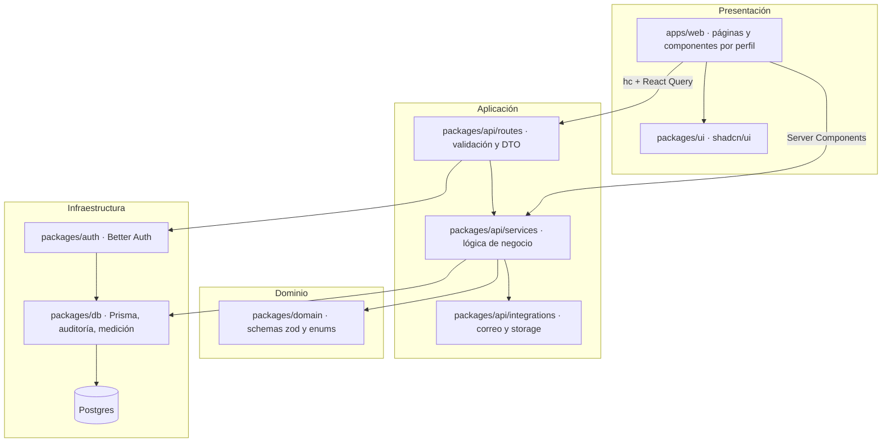
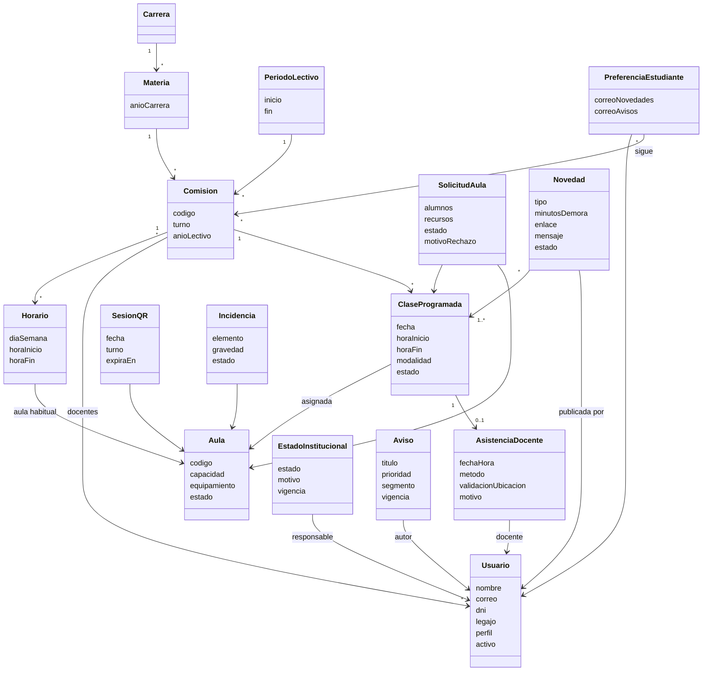
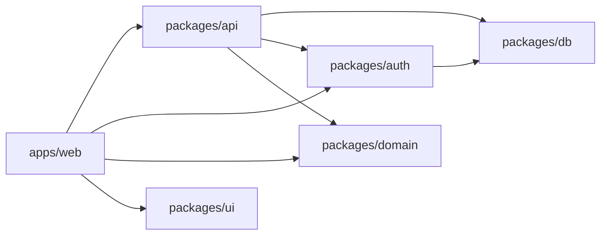
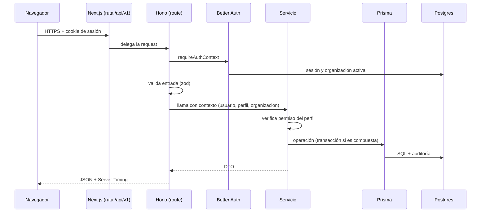
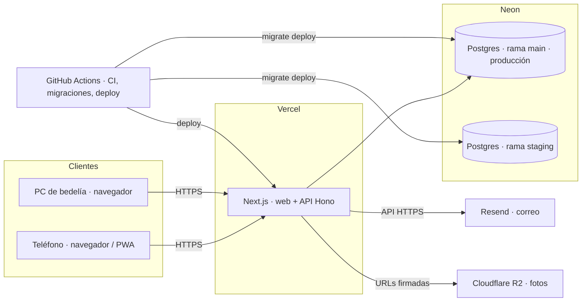

# Documento de arquitectura de software: vistas

Arquitectura de SiGA según el modelo de vistas 4+1 (Kruchten): lógica, de desarrollo, de procesos, física y escenarios. Describe el sistema tal como se construye en este repo (`../arquitectura.md`, `../api.md`, `../autenticacion.md`); las decisiones técnicas están en `../decisiones/`.

## 1. Resumen y decisiones principales

| Decisión      | Elección                                                                                                   | Motivo                                                                                                         |
| ------------- | ---------------------------------------------------------------------------------------------------------- | -------------------------------------------------------------------------------------------------------------- |
| Aplicación    | Next.js 16 (App Router) + React 19, instalable como PWA.                                                   | Un solo artefacto para web y móvil; mobile first (RNF-01).                                                     |
| API           | Hono con `@hono/zod-openapi` montada en `/api/v1` dentro de Next.js.                                       | Contrato OpenAPI tipado, consumible por un cliente iOS futuro; extraíble a servicio propio sin cambios.        |
| Validaciones  | zod en `packages/domain`.                                                                                  | Una sola fuente de verdad entre API y UI.                                                                      |
| Persistencia  | Postgres en Neon con Prisma 7, migraciones versionadas.                                                    | Transacciones y restricciones de unicidad para las reglas críticas (aula sin superposición, asistencia única). |
| Autenticación | Better Auth: correo y contraseña, verificación de correo, recuperación, sesión por cookie o bearer.        | Cubre RF-10, RF-11 y RF-12 sin desarrollo propio.                                                              |
| Tenant        | Organización de Better Auth = institución. Una sola precargada en el MVP.                                  | Multi-institución futura sin rediseño.                                                                         |
| UI            | shadcn/ui en `packages/ui`, Tailwind 4, React Query.                                                       | Sin componentes propios; consistencia y accesibilidad.                                                         |
| Tiempo real   | React Query con consulta periódica cada 30 s en las vistas de clases, aulas y estado institucional.        | Cumple la latencia máxima de 60 s sin infraestructura adicional.                                               |
| Correo        | Resend con cola de salida en base (`EmailOutbox`), procesada después de responder.                         | Reintentos y registro del resultado de cada envío (RF-14).                                                     |
| Archivos      | Almacenamiento S3-compatible (Cloudflare R2) con URLs firmadas.                                            | Fotos de incidencias (RF-15).                                                                                  |
| Auditoría     | Extensión de Prisma que registra `create`, `update` y `delete` de las entidades auditadas con actor.       | RNF-03 sin código repetido en cada servicio.                                                                   |
| Despliegue    | Vercel; GitHub Actions corre migraciones antes del deploy; ramas `develop` → staging, `main` → producción. | Despliegues reproducibles y reversibles.                                                                       |

## 2. Vista lógica

### 2.1 Capas y módulos

Reglas: las rutas no contienen lógica; los servicios no conocen Hono ni Next.js; `domain` no depende de nada del repo.

### 2.2 Servicios de negocio

| Servicio               | Responsabilidad                                                                                                           | Requisitos          |
| ---------------------- | ------------------------------------------------------------------------------------------------------------------------- | ------------------- |
| `usuarios`             | Perfiles, alta por administrador, activación, desactivación lógica, autorregistro de estudiantes con dominios permitidos. | RF-10, RF-11, RF-12 |
| `datos-academicos`     | Carreras, materias, comisiones, horarios, períodos lectivos, días no laborables; generación de clases programadas.        | RF-13               |
| `estado-institucional` | Cambios de estado con historial; suspensión de clases al cerrar.                                                          | RF-01, RF-08        |
| `clases`               | Estado de clases por fecha y filtros; transición a Finalizada.                                                            | RF-07               |
| `novedades`            | Publicación, edición y cierre; efecto sobre el estado de la clase; disparo de notificaciones.                             | RF-05               |
| `aulas`                | ABM, estado, ocupación calculada, clases afectadas.                                                                       | RF-02               |
| `solicitudes-aula`     | Búsqueda de disponibilidad, solicitud, asignación inmediata, aprobación y rechazo atómicos, novedad de cambio de aula.    | RF-06, RF-16        |
| `incidencias`          | Registro, historial de estados, propuesta de Fuera de servicio, fotos.                                                    | RF-15               |
| `asistencia`           | Sesiones de QR con token firmado y renovación; validación de token, comisión y presencia; registro manual.                | RF-03, RF-04, RF-18 |
| `avisos`               | Avisos segmentados, vigencia, envío por correo con resultado.                                                             | RF-14               |
| `preferencias`         | Comisiones seguidas y opciones de correo.                                                                                 | RF-17               |
| `historico`            | Consultas consolidadas e indicadores.                                                                                     | RF-09               |
| `parametros`           | Turnos, ubicación y radio, red institucional, dominios permitidos.                                                        | CFG-1               |

### 2.3 Modelo de dominio

Clases de diseño derivadas del modelo de dominio conceptual (`01-modelo-de-dominio.md`), que es donde están las definiciones, reglas, estados e invariantes de cada concepto. Acá se muestra la versión que implementan los servicios.

## 3. Vista de desarrollo

### 3.1 Organización del monorepo

| Paquete           | Contenido                                                                                                             | Tecnología                       |
| ----------------- | --------------------------------------------------------------------------------------------------------------------- | -------------------------------- |
| `apps/web`        | Rutas del App Router por perfil (`(auth)`, `(app)`), componentes compuestos, hooks de React Query, cliente `hc`, PWA. | Next.js 16, React 19, Tailwind 4 |
| `packages/api`    | `routes/`, `services/`, `integrations/`, `openapi.json`.                                                              | Hono, `@hono/zod-openapi`        |
| `packages/domain` | Schemas y enums: perfiles, estados de clase, tipos de novedad, estados de aula, turnos.                               | zod                              |
| `packages/db`     | `schema.prisma`, migraciones, extensión de auditoría y medición.                                                      | Prisma 7                         |
| `packages/auth`   | Instancia de Better Auth, `requireAuthContext`, hooks de organización.                                                | Better Auth                      |
| `packages/ui`     | Componentes shadcn/ui, tokens, hooks de registry.                                                                     | shadcn/ui                        |

### 3.2 Estructura de rutas de la web

| Grupo              | Rutas                                                                                                   | Perfil     |
| ------------------ | ------------------------------------------------------------------------------------------------------- | ---------- |
| `(auth)`           | `/login`, `/registro`, `/verificar-correo`, `/recuperar-contrasena`, `/definir-contrasena/[token]`      | Público    |
| `(app)/estudiante` | `/`, `/buscar`, `/avisos`, `/preferencias`                                                              | Estudiante |
| `(app)/docente`    | `/`, `/novedades/nueva`, `/asistencia`, `/solicitar-aula`, `/incidencias/nueva`                         | Docente    |
| `(app)/bedel`      | `/estado`, `/aulas`, `/qr`, `/solicitudes`, `/incidencias`, `/avisos`, `/usuarios`, `/datos-academicos` | Bedel      |
| `(app)/autoridad`  | `/historico`, `/avisos`, `/usuarios`                                                                    | Autoridad  |
| `(app)`            | `/mi-perfil`, `/configuracion`                                                                          | Todos      |

### 3.3 Recursos de la API (`/api/v1`)

| Recurso                                                                                  | Operaciones                                                | Requisitos   |
| ---------------------------------------------------------------------------------------- | ---------------------------------------------------------- | ------------ |
| `/estado-institucional`                                                                  | GET vigente e historial; POST cambio.                      | RF-01, RF-08 |
| `/clases`                                                                                | GET por fecha y filtros (carrera, año, comisión, materia). | RF-07        |
| `/novedades`                                                                             | GET, POST, PATCH, POST `/finalizar`.                       | RF-05        |
| `/aulas`                                                                                 | GET, POST, PATCH, DELETE lógico; GET `/disponibles`.       | RF-02, RF-06 |
| `/solicitudes-aula`                                                                      | GET, POST; POST `/aprobar`, `/rechazar`.                   | RF-06, RF-16 |
| `/clases/{id}/aula`                                                                      | PUT asignación.                                            | RF-16        |
| `/incidencias`                                                                           | GET, POST, PATCH estado; POST foto.                        | RF-15        |
| `/qr-sesiones`                                                                           | POST generar; GET `/{id}/token` vigente.                   | RF-03        |
| `/asistencias`                                                                           | POST por QR; POST manual.                                  | RF-04, RF-18 |
| `/avisos`                                                                                | GET, POST.                                                 | RF-14        |
| `/preferencias`                                                                          | GET, PUT.                                                  | RF-17        |
| `/usuarios`                                                                              | GET, POST, PATCH, POST `/desactivar`.                      | RF-10        |
| `/carreras`, `/materias`, `/comisiones`, `/horarios`, `/periodos`, `/dias-no-laborables` | ABM; POST `/comisiones/generar-clases`.                    | RF-13        |
| `/historico/{tipo}`                                                                      | GET con rango y filtros.                                   | RF-09        |
| `/parametros`                                                                            | GET, PATCH.                                                | CFG-1        |

Autenticación en `/api/auth/*` (Better Auth). Errores con un único formato `{ error: { code, message, issues? } }` en español.

### 3.4 Calidad y entrega

Lint, typecheck, pruebas unitarias (Vitest), de integración de la API contra Postgres real, e2e con Playwright, verificación de contratos (`openapi.json` y migraciones) en GitHub Actions. Ramas `feat/<issue>-<slug>` → PR a `develop` → staging; `develop` → `main` → producción.

## 4. Vista de procesos

### 4.1 Ciclo de una solicitud

### 4.2 Trabajo diferido y correo

Lo que puede esperar a después de responder (correos de novedades, avisos, activación) se encola en `EmailOutbox` dentro de la misma transacción y se procesa con `runDeferred` tras enviar la respuesta. Cada envío registra `SENT` o `FAILED` con el error, lo que alimenta el resultado de envíos de RF-14. Los reintentos usan `attempts` y `sendAfter`.

### 4.3 Tiempo real

Las vistas de Mis clases, Aulas, Solicitudes y el indicador de estado institucional usan React Query con `refetchInterval` de 30 segundos y refetch al recuperar el foco. Latencia máxima observada: 30 s más el tiempo de respuesta, por debajo de los 60 s de RNF-02. Las mutaciones del propio usuario invalidan las consultas afectadas, por lo que sus cambios se ven de inmediato.

### 4.4 Procesos temporizados

| Proceso                | Disparo                                                                           | Efecto                                             |
| ---------------------- | --------------------------------------------------------------------------------- | -------------------------------------------------- |
| Renovación del QR      | Cada 60 s mientras la pantalla está abierta.                                      | El cliente pide un token nuevo; el anterior vence. |
| Finalización de clases | Al consultar clases, el servicio marca Finalizada toda clase cuya franja terminó. | Sin tarea programada: evaluación perezosa al leer. |
| Vencimiento de avisos  | Al listar avisos se filtran por vigencia.                                         | Igual, evaluación al leer.                         |
| Vencimiento de enlaces | Verificación 24 h, recuperación 60 min.                                           | Better Auth.                                       |

### 4.5 Concurrencia en la asignación de aulas

La aprobación de una solicitud y la asignación directa corren en una transacción que vuelve a comprobar la disponibilidad del aula en la franja y escribe la asignación; una restricción de exclusión en la base impide dos clases con la misma aula y franjas superpuestas, de modo que la segunda operación concurrente falla con un conflicto que la API devuelve como 409.

## 5. Vista física

| Nodo           | Rol                                                                                    | Ambientes                                                                  |
| -------------- | -------------------------------------------------------------------------------------- | -------------------------------------------------------------------------- |
| Vercel         | Ejecuta la aplicación Next.js y la API.                                                | `siga-orcin-staging.vercel.app` (develop), `siga-orcin.vercel.app` (main). |
| Neon           | Postgres serverless; ramas `main` y `staging`.                                         | Copias de seguridad y restauración por rama (FIAB-3, FIAB-4).              |
| Resend         | Entrega de correo transaccional desde dominio con SPF, DKIM y DMARC.                   | Todos.                                                                     |
| Cloudflare R2  | Fotos de incidencias comprimidas a 1 MB.                                               | Todos.                                                                     |
| GitHub Actions | Lint, typecheck, tests, contratos; migraciones antes de cada deploy.                   | CI por PR; deploy por rama.                                                |
| Dispositivos   | Teléfono del docente (cámara, ubicación), PC o tablet de bedelía (QR legible a 50 cm). | —                                                                          |

## 6. Vista de escenarios

Escenarios que validan la arquitectura; su detalle de interacción está en `08-diagramas-de-colaboracion.md` y el de interfaz en `07-casos-de-uso-reales.md`.

| Escenario                                                                                        | Casos de uso        | Atributos que ejercita                                                      |
| ------------------------------------------------------------------------------------------------ | ------------------- | --------------------------------------------------------------------------- |
| El estudiante ve, antes de salir de su casa, que su clase de las 19:00 está demorada 15 minutos. | CU-11, CU-13        | Latencia ≤ 60 s, usabilidad (≤ 2 interacciones), mobile first.              |
| El docente escanea el QR en el aula y los estudiantes ven "Docente presente".                    | CU-24, CU-26, CU-27 | Seguridad del token, validación de presencia, transacción compuesta, ≤ 5 s. |
| Dos bedeles intentan asignar la misma aula en la misma franja.                                   | CU-19, CU-20        | Integridad transaccional, restricción de exclusión.                         |
| Bedelía cierra la institución por un paro.                                                       | CU-29, CU-34, CU-31 | Suspensión masiva atómica, indicador global, aviso con correo.              |
| La autoridad consulta la asistencia docente del último cuatrimestre.                             | CU-35               | Consultas históricas < 10 s, auditoría inmutable, privacidad por perfil.    |
