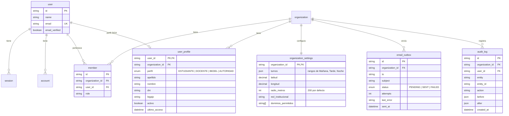
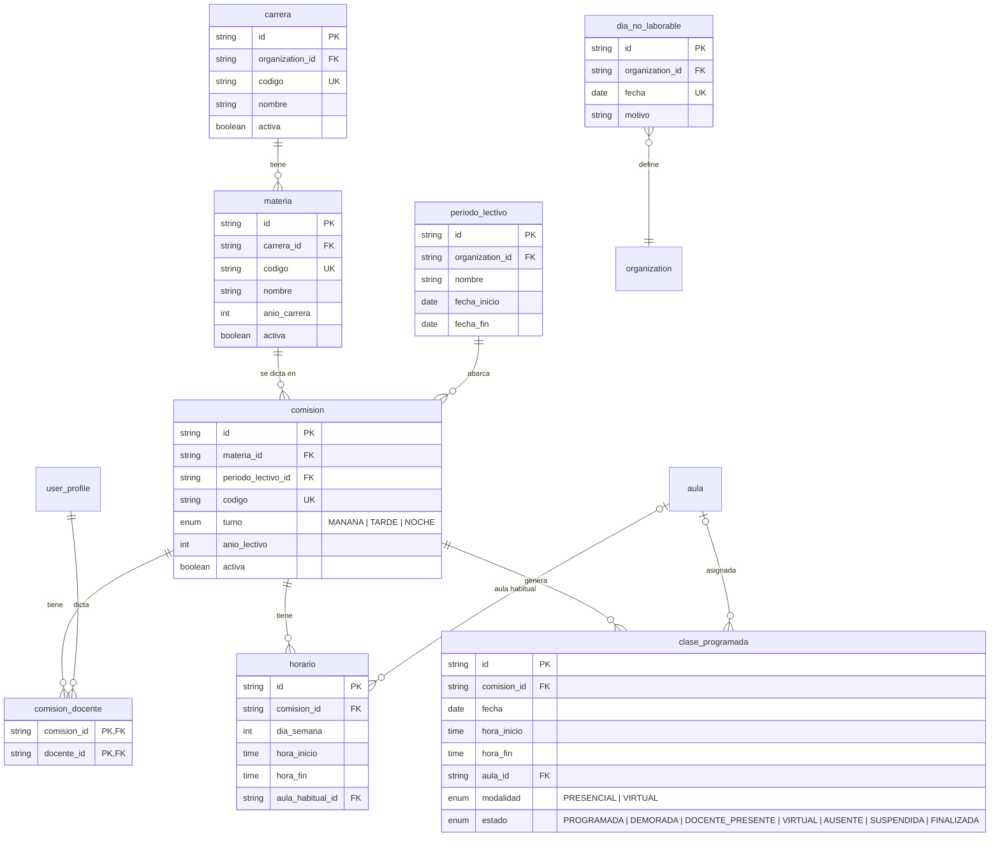
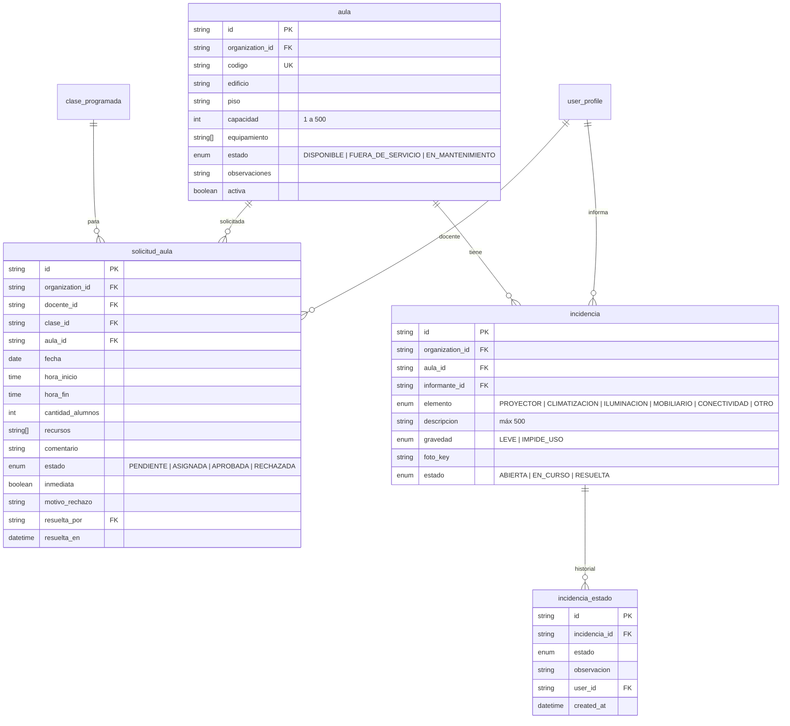
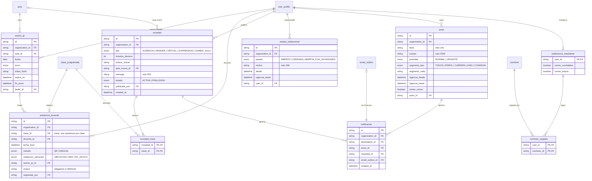

# Modelo de base de datos

Modelo físico propuesto para SiGA sobre Postgres con Prisma, extendiendo el esquema base del repo (`../modelo-de-datos.md`: Better Auth, organizaciones, cola de correo, auditoría). Toda entidad del producto cuelga de `organization` con `organization_id` y las consultas filtran por la organización de la sesión. Nombres de tabla en `snake_case`; fechas en UTC.

## Diagrama entidad-relación

### Base (template) y usuarios

### Datos académicos y clases

### Aulas, solicitudes e incidencias

### Asistencia, novedades, estado institucional, avisos y preferencias

## Diccionario de tablas

| Tabla                                        | Descripción                                                   | Claves y restricciones                                                                                                                                                                                                                                                            |
| -------------------------------------------- | ------------------------------------------------------------- | --------------------------------------------------------------------------------------------------------------------------------------------------------------------------------------------------------------------------------------------------------------------------------- |
| `user_profile`                               | Datos de SiGA de cada usuario: perfil, DNI, legajo, activo.   | PK `user_id`; única `(organization_id, dni)`; `activo` para baja lógica.                                                                                                                                                                                                          |
| `organization_settings`                      | Parámetros de la institución.                                 | Turnos como JSON; ubicación, radio, red, dominios permitidos.                                                                                                                                                                                                                     |
| `carrera`, `materia`                         | Estructura académica.                                         | Códigos únicos por organización y por carrera.                                                                                                                                                                                                                                    |
| `periodo_lectivo`                            | Rango de fechas de cursado.                                   | `fecha_fin > fecha_inicio`.                                                                                                                                                                                                                                                       |
| `comision`                                   | Grupo de cursado.                                             | Código único por organización; pertenece a materia y período.                                                                                                                                                                                                                     |
| `comision_docente`                           | Docentes asignados a una comisión.                            | PK compuesta; `docente_id` debe tener perfil DOCENTE.                                                                                                                                                                                                                             |
| `horario`                                    | Franja semanal.                                               | `hora_fin > hora_inicio`; aula habitual sin superposición.                                                                                                                                                                                                                        |
| `dia_no_laborable`                           | Fechas excluidas de la generación.                            | Única `(organization_id, fecha)`.                                                                                                                                                                                                                                                 |
| `clase_programada`                           | Instancia de dictado.                                         | Única `(comision_id, fecha, hora_inicio)`; índice `(fecha, aula_id)`; restricción de exclusión por aula y franja (`EXCLUDE USING gist` sobre `aula_id` y `tsrange(fecha+hora_inicio, fecha+hora_fin)`), que es lo que impide dos clases en la misma aula en franjas superpuestas. |
| `aula`                                       | Espacio físico.                                               | Código único por organización; `capacidad BETWEEN 1 AND 500`; `activa` para baja lógica. "Ocupada" se calcula.                                                                                                                                                                    |
| `solicitud_aula`                             | Pedido de aula de un docente.                                 | `motivo_rechazo` obligatorio si RECHAZADA; `inmediata` marca la asignación a menos de 30 min.                                                                                                                                                                                     |
| `incidencia`, `incidencia_estado`            | Problema de infraestructura y su historial.                   | Historial solo inserta; nunca se borra.                                                                                                                                                                                                                                           |
| `sesion_qr`                                  | Código de asistencia por aula, fecha y turno.                 | `token_hash` del token vigente; `expira_en` ≤ 60 s; inválida tras `fin_turno`.                                                                                                                                                                                                    |
| `asistencia_docente`                         | Presencia registrada.                                         | Única `clase_id` (una asistencia por clase); `motivo` obligatorio si `metodo = MANUAL`; nunca se actualiza ni borra.                                                                                                                                                              |
| `novedad`, `novedad_clase`                   | Novedad y las clases que abarca.                              | Una novedad puede abarcar varias clases de la misma comisión; `aula_nueva_id` solo para CAMBIO_AULA.                                                                                                                                                                              |
| `estado_institucional`                       | Historial de estados.                                         | Solo inserta; el vigente es el de `desde` más reciente.                                                                                                                                                                                                                           |
| `aviso`                                      | Comunicado.                                                   | `vigencia_hasta ≥ vigencia_desde`; segmento por tipo y valor.                                                                                                                                                                                                                     |
| `notificacion`                               | Vínculo entre aviso o novedad, destinatario y correo en cola. | Exactamente uno de `aviso_id` o `novedad_id`; el resultado del envío vive en `email_outbox.status`.                                                                                                                                                                               |
| `preferencia_estudiante`, `comision_seguida` | Comisiones seguidas y opciones de correo.                     | PK por usuario; PK compuesta en la relación.                                                                                                                                                                                                                                      |
| `audit_log`                                  | Eventos de auditoría (ya existe).                             | Las tablas de SiGA se agregan a `auditedModels`; nunca se actualiza ni borra.                                                                                                                                                                                                     |

## Reglas implementadas en la base

- **Sin superposición de aulas**: restricción de exclusión en `clase_programada` por aula y rango horario (requiere la extensión `btree_gist`). Las asignaciones corren en una transacción y el conflicto se devuelve como 409.
- **Una asistencia por clase**: índice único en `asistencia_docente.clase_id`.
- **Inmutabilidad**: `asistencia_docente`, `novedad`, `estado_institucional`, `incidencia_estado` y `audit_log` no admiten `UPDATE` ni `DELETE` desde la aplicación; las correcciones son filas nuevas.
- **Bajas lógicas**: `activo`/`activa` en `user_profile`, `aula`, `carrera`, `materia`, `comision`.
- **Multi-tenant**: `organization_id` en todas las tablas del producto, con `ON DELETE CASCADE` e índices por organización.
- **Zona horaria**: columnas `timestamptz`; la aplicación presenta en UTC−3.

## Migraciones

Cada entidad se agrega con su migración en `packages/db/prisma/migrations` siguiendo el orden de desarrollo: usuarios y datos académicos → estado institucional y novedades → aulas, solicitudes e incidencias → QR y asistencia → avisos, notificaciones y preferencias → índices de históricos.
