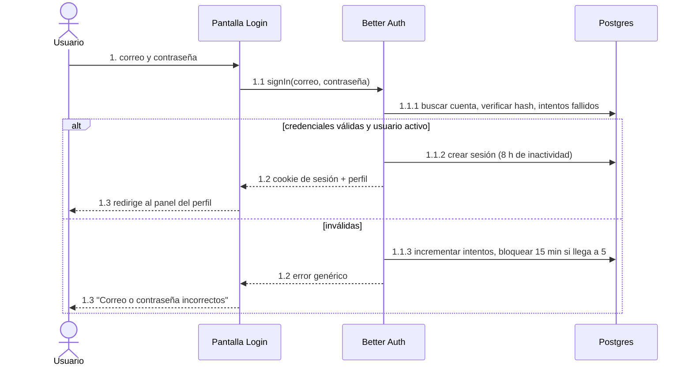
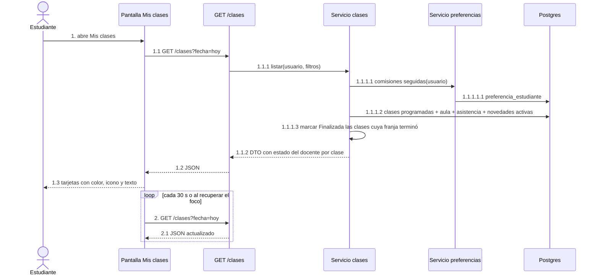
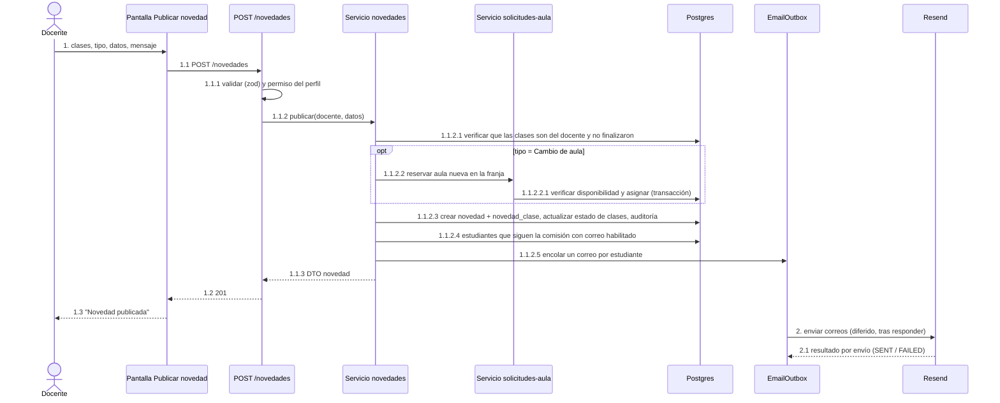
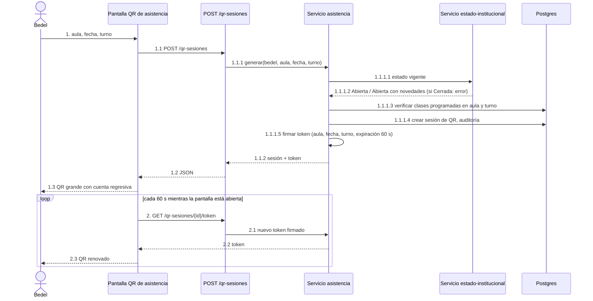
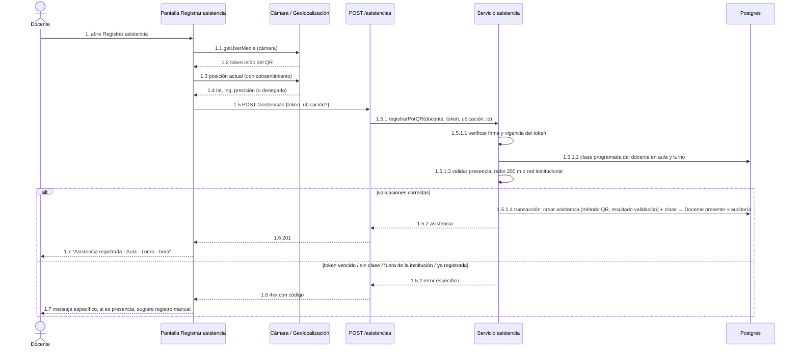
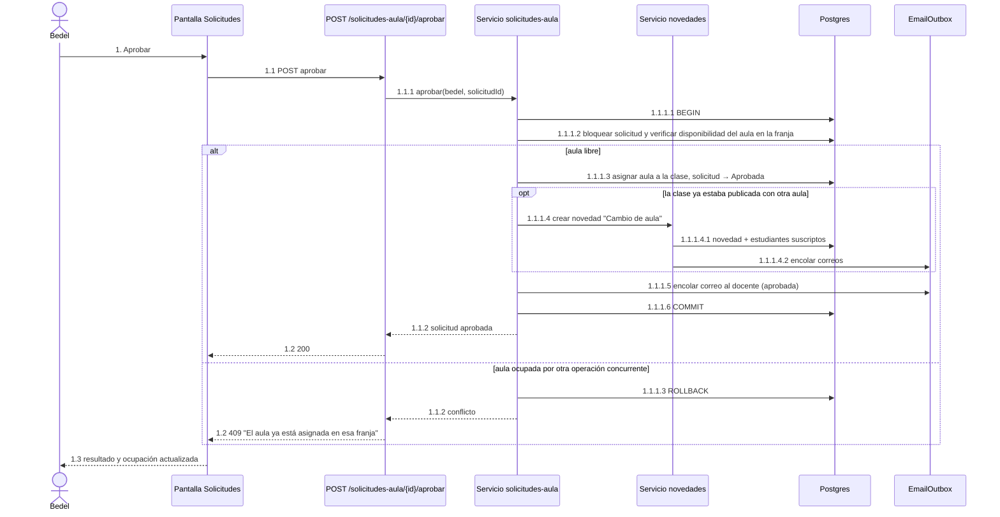
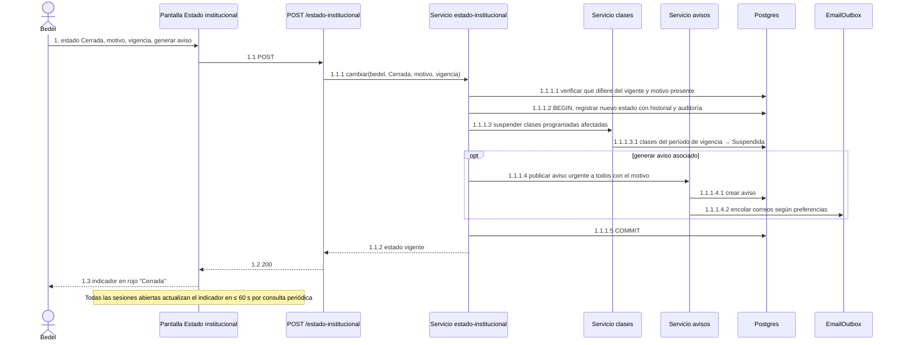
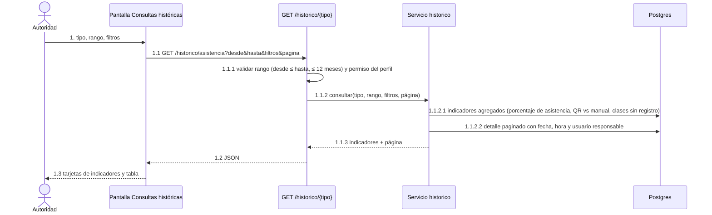

# Diagramas de colaboración

Interacción entre objetos para los casos de uso principales. Mermaid no tiene diagrama de comunicación (colaboración) nativo, por lo que se usan diagramas de secuencia con los mensajes numerados jerárquicamente (1, 1.1, 1.2…), que es la información que un diagrama de colaboración agrega sobre uno de secuencia. Los participantes son los objetos de la arquitectura (`06-arquitectura-vistas.md`): pantalla, ruta de la API, servicio, repositorio (Prisma), cola de correo y servicios externos.

## CU-01 Iniciar sesión

## CU-11 Consultar mis clases de hoy

## CU-13 Publicar novedad de clase (con notificación)

## CU-24 Generar QR de asistencia

## CU-26 Registrar asistencia por QR

## CU-19 Aprobar solicitud de aula

## CU-29 Registrar cierre de la institución

## CU-35 Consultar históricos consolidados

